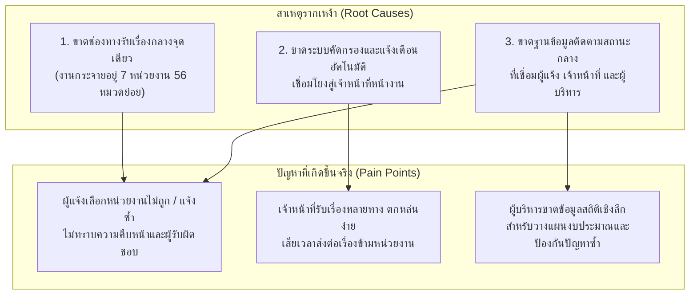
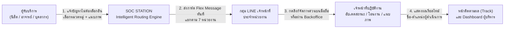
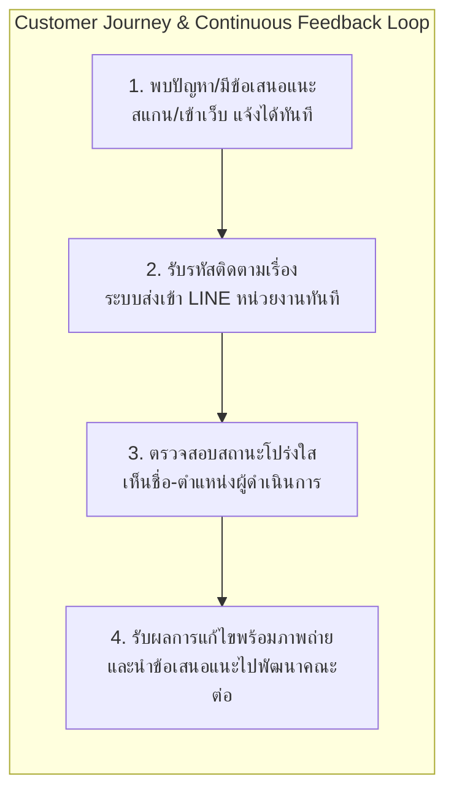
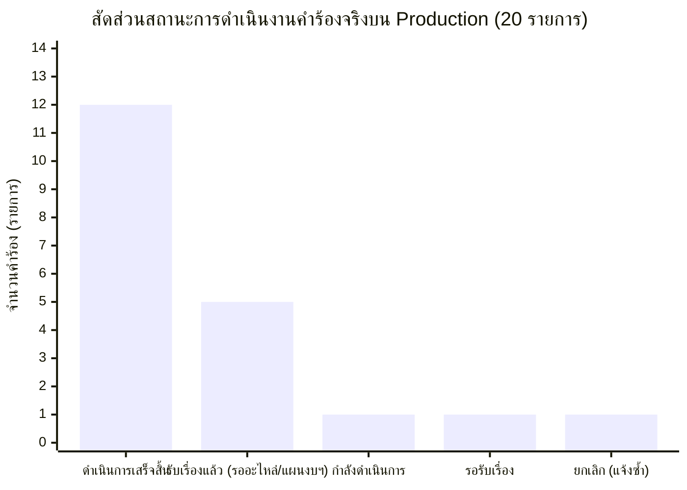
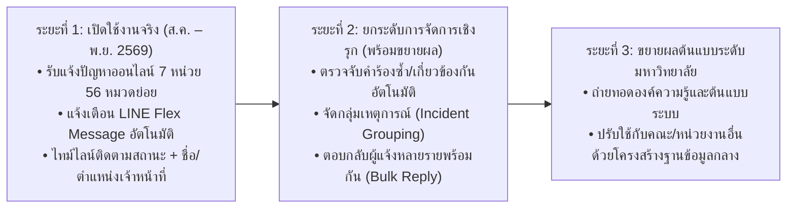

# เนื้อหานำเสนอผลงานนวัตกรรม: SOC STATION
## ระบบรับแจ้งปัญหาและติดตามการดำเนินงานแบบเบ็ดเสร็จ คณะสังคมศาสตร์ มหาวิทยาลัยเกษตรศาสตร์

> [!IMPORTANT]
> **หลักการอ้างอิงข้อมูลในเอกสารฉบับนี้**
> เอกสารฉบับนี้จัดทำขึ้นจากการสำรวจข้อมูลจริงในฐานข้อมูล **Production (`supportsoc.vercel.app`)**, โครงสร้างระบบที่เปิดใช้งานจริง, ประวัติการดำเนินงาน (`report_logs`, `audit_logs`), และเอกสารการพัฒนาในโครงการ โดยแยกสถานะของข้อมูลทุกประเด็นออกเป็น 3 ระดับอย่างชัดเจน:
> - ✅ **[ข้อมูลที่ยืนยันได้]:** มีข้อมูลจริงในฐานข้อมูล Production, หน้าจอใช้งานจริง หรือเอกสารหลักฐานในระบบรองรับ
> - ⚠️ **[ข้อมูลที่มีอยู่แต่ต้องยืนยันเพิ่มเติม]:** มีข้อมูลในระบบทดสอบ (Localhost/Staging) หรือมีร่องรอยในระบบ แต่ต้องยืนยันขอบเขตการนำไปใช้จริงกับผู้รับผิดชอบโครงการ
> - 📌 **[ต้องเพิ่มเติมข้อมูล]:** ข้อมูลเชิงบริบท ผลสำรวจความพึงพอใจ หรือสถิติก่อนมีระบบ (Baseline ก่อน ส.ค. 2569) ที่ไม่ได้เก็บไว้ในฐานข้อมูลของซอฟต์แวร์ ต้องขอเพิ่มจากหน่วยงาน

---

# ส่วนที่ 1: ภาพรวมผลงาน (Executive Summary)

| หัวข้อ | รายละเอียดเนื้อหา | สถานะข้อมูล |
| :--- | :--- | :---: |
| **ชื่อผลงาน** | **SOC STATION** — ระบบรับแจ้งปัญหาและติดตามการดำเนินงานแบบเบ็ดเสร็จ คณะสังคมศาสตร์ มหาวิทยาลัยเกษตรศาสตร์ | ✅ ยืนยันได้ |
| **หน่วยงานเจ้าของผลงาน** | สำนักงานเลขานุการ คณะสังคมศาสตร์ มหาวิทยาลัยเกษตรศาสตร์ (บูรณาการการทำงานร่วมกัน 7 หน่วยปฏิบัติการหลัก และทีมผู้บริหารคณะ) | ✅ ยืนยันได้ |
| **แนวคิดหลัก (Core Concept)** | **"แจ้งง่าย ไม่ต้องล็อกอิน · ส่งตรงถึงหน่วยปฏิบัติการผ่าน LINE ทันที · ติดตามสถานะโปร่งใสตรวจสอบได้ทุกขั้นตอน"** เปลี่ยนการรับแจ้งปัญหาแบบแยกส่วน ให้เป็นศูนย์กลางบริการดิจิทัลจุดเดียว (One-Stop Digital Service) ที่เชื่อมผู้รับบริการ เจ้าหน้าที่ และผู้บริหารเข้าด้วยกันแบบไร้รอยต่อ | ✅ ยืนยันได้ |
| **ปัญหาที่ต้องการแก้ไข** | 1. ผู้รับบริการ (นิสิต อาจารย์ บุคลากร) ไม่ทราบว่าปัญหาแต่ละเรื่องต้องแจ้งที่หน่วยงานใด ทำให้แจ้งผิดช่องทางหรือเรื่องตกหล่น 2. ผู้แจ้งไม่สามารถติดตามความคืบหน้าได้ว่าเรื่องของตนรับแล้วหรือยัง ใครเป็นผู้รับผิดชอบ และจะเสร็จเมื่อใด 3. เจ้าหน้าที่รับเรื่องกระจัดกระจายหลายช่องทาง ขาดประวัติงานกลาง และเสียเวลาส่งต่อเรื่องข้ามหน่วยงาน 4. ผู้บริหารขาดข้อมูลสถิติภาพรวมสำหรับวางแผนงบประมาณและแก้ไขปัญหาเชิงรุก | ✅ ยืนยันได้จากโครงสร้างระบบและเคสจริงใน Production |
| **กลุ่มเป้าหมาย** | 1. **ผู้รับบริการ (ผู้แจ้งเรื่อง):** นิสิต อาจารย์ บุคลากร และผู้มาติดต่อภายในคณะสังคมศาสตร์ มก. 2. **ผู้ปฏิบัติงาน:** เจ้าหน้าที่และหัวหน้างานรวม **17 บัญชีผู้ใช้งาน** จาก **7 หน่วยงาน** (ทะเบียนและประมวลผล, กิจการนิสิต, บริหารงานบุคคล, กายภาพและสิ่งแวดล้อม, ดิจิทัลและเทคโนโลยีการศึกษา, ส่งเสริมการเรียนรู้และสารสนเทศ/ห้องสมุด, สารบรรณ) 3. **ผู้บริหารคณะ:** ใช้ติดตาม KPIs และพิจารณาข้อเสนอแนะเชิงนโยบาย | ✅ ยืนยันได้ |
| **จุดเด่นของผลงาน** | 1. **Zero-Login Public Access:** แจ้งเรื่องพร้อมภาพถ่ายและระบุประเภทผู้แจ้งได้ทันทีโดยไม่ต้องสมัครสมาชิก 2. **Auto-Routing to Department LINE Group:** คัดกรองหมวดหมู่ (7 หมวดหลัก 56 หมวดย่อย) ส่งเข้ากลุ่ม LINE ของหน่วยงานที่รับผิดชอบทันทีในรูปแบบ Flex Message พร้อมลิงก์กดรับงานด่วน 3. **Transparent Step-by-Step Timeline:** แสดงไทม์ไลน์ 4 ขั้นตอน พร้อมชื่อและตำแหน่งเจ้าหน้าที่ผู้รับผิดชอบ ข้อความตอบกลับ และภาพถ่ายหลังแก้ไขเสร็จสิ้น โดยปกป้องข้อมูลส่วนบุคคล (PII Redaction & Phone Masking) 4. **Seamless Inter-Department Transfer:** โอนย้ายคำร้องข้ามหน่วยงานได้ในคลิกเดียวเมื่อผู้แจ้งเลือกหมวดหมู่ผิด พร้อมแจ้งเตือน LINE หน่วยงานปลายทางอัตโนมัติ | ✅ ยืนยันได้ |
| **สรุปคุณค่าของผลงานในภาพรวม** | ยกระดับคุณภาพการให้บริการของคณะสังคมศาสตร์จากระบบตั้งรับสู่ระบบดิจิทัลที่โปร่งใส ตรวจสอบได้ ลดขั้นตอนการประสานงานข้ามหน่วยงาน สร้างความเชื่อมั่นให้แก่นิสิตและบุคลากรว่าทุกเสียงสะท้อนและปัญหาความเดือดร้อนมีเจ้าภาพรับผิดชอบและนำไปสู่การแก้ไขจริง ทั้งงานซ่อมบำรุงรายวันไปจนถึงการปรับปรุงเชิงนโยบายของคณะ | ✅ ยืนยันได้ |

---

# ส่วนที่ 2: เนื้อหานำเสนอตามเกณฑ์การประเมินทั้ง 4 มิติ 10 ข้อ

---

## มิติที่ 1: การวิเคราะห์ปัญหา (10 คะแนน)

### ข้อ 1: สภาพปัญหา ที่มา และสาเหตุของปัญหา (8 คะแนน)

#### 1. ประเด็นสำคัญที่ต้องการสื่อ
การจัดการปัญหาและเรื่องร้องเรียนภายในคณะสังคมศาสตร์มีความซับซ้อนเนื่องจากครอบคลุมภารกิจถึง 7 หน่วยงาน (56 ประเภทปัญหาย่อย) ก่อนมีระบบ SOC STATION การรับแจ้งปัญหาขาดศูนย์กลางเดียว ทำให้ผู้แจ้งสับสนหน่วยงาน เจ้าหน้าที่รับเรื่องซ้ำซ้อนหรือตกหล่น และขาดกลไกติดตามผลที่โปร่งใส

#### 2. เนื้อหาสำหรับใส่สไลด์
- **สภาพปัญหาและ Pain Points ก่อนพัฒนา (Before):**
  - **ฝั่งผู้รับบริการ (นิสิต / อาจารย์ / บุคลากร):**
    - ไม่ทราบว่าปัญหาที่พบต้องแจ้งที่หน่วยงานใด (เช่น เก้าอี้ชำรุดในห้องเรียน ต้องแจ้งงานบริการการศึกษา หรือหน่วยกายภาพฯ)
    - หลังแจ้งเรื่องแล้วเกิดสภาวะ **"ไร้ร่องรอย"** ไม่ทราบว่าเรื่องถึงมือเจ้าหน้าที่หรือยัง ใครเป็นผู้รับผิดชอบ และดำเนินการถึงขั้นตอนใด
    - กรณีปัญหาจุดเดียวในพื้นที่ส่วนกลาง มีผู้แจ้งหลายรายแจ้งซ้ำกันโดยไม่ทราบว่ามีคนแจ้งไปแล้ว
  - **ฝั่งเจ้าหน้าที่ผู้ปฏิบัติงาน:**
    - รับเรื่องผ่านหลายช่องทางที่ไม่เป็นระบบ (แจ้งด้วยวาจา โทรศัพท์ หรือแชตส่วนตัว) ทำให้ยากต่อการรวบรวมและจัดลำดับงาน
    - เมื่อมีเรื่องแจ้งผิดหน่วยงาน ต้องเสียเวลาประสานงานส่งต่อเรื่องเองและขาดบันทึกประวัติการส่งต่อ
  - **ฝั่งผู้บริหารคณะ:**
    - ขาดข้อมูลสถิติ реаль-time ว่าปัญหาใดเกิดซ้ำบ่อยที่สุด อาคารหรือจุดใดมีปัญหาสะสม และแต่ละหน่วยงานใช้เวลาแก้ไขเฉลี่ยเท่าใด
- **การวิเคราะห์สาเหตุที่แท้จริง (Root Cause Analysis):**
  1. **ขาดช่องทางรับเรื่องกลาง (No Single Point of Contact):** โครงสร้างงานแบ่งตามภารกิจ 7 หน่วยงาน แต่ผู้รับบริการมองปัญหาตามพื้นที่หรือสถานการณ์จริง
  2. **ขาดระบบคัดกรองและส่งต่องานอัตโนมัติ (Manual Routing):** การส่งเรื่องจากจุดรับแจ้งไปยังเจ้าหน้าที่หน้างานต้องพึ่งพาคนกลาง
  3. **ขาดฐานข้อมูลและไทม์ไลน์กลาง (No Centralized Status & Audit Log):** ข้อมูลการแก้ไขงานอยู่แยกตามบุคคล ไม่เชื่อมโยงกลับมายังผู้แจ้ง

#### 3. หลักฐานจริงที่รองรับ
- ✅ **[ข้อมูลที่ยืนยันได้]:** โครงสร้างหมวดหมู่จริงในฐานข้อมูล Production แบ่งออกเป็น **7 หมวดหมู่หลัก 56 หมวดหมู่ย่อย** กระจายตาม **7 หน่วยงานปฏิบัติการ** ซึ่งสะท้อนความซับซ้อนของภารกิจในคณะ
- ✅ **[ข้อมูลที่ยืนยันได้]:** ข้อมูลจากตาราง `reports` และ `report_logs` บน Production ยืนยันว่าแม้มีระบบแล้ว ผู้แจ้งก็ยังมีความสับสนในขอบเขตงานของหน่วยงาน เช่น:
  - คำร้อง `SOC-11190` (พัดลมพังที่ซุ้มสังมา) ผู้แจ้งเลือกหมวด *"ชมรม/สโมสรนิสิต"* (หน่วยกิจการนิสิต) เจ้าหน้าที่ต้องใช้ฟีเจอร์ **โอนคำร้อง (`transfer`)** ส่งต่อไปยัง *"หน่วยกายภาพและสิ่งแวดล้อม"*
  - คำร้อง `SOC-80397` (ข้อเสนอแนะขอห้องละหมาด) ถูกโอนจาก *"หน่วยสารบรรณ"* ไปยัง *"หน่วยกายภาพและสิ่งแวดล้อม"*
  - คำร้อง `SOC-40767` (เก้าอี้เป็นสนิมห้อง สค 1-202) ผู้แจ้งเลือกหมวด *"วิชาการและการเรียนการสอน"* ก่อนส่งใหม่ในหมวดกายภาพฯ (`SOC-68573`)
  - เหตุการณ์พัดลมเสียและนกพิราบที่ซุ้มสังมาในวันที่ 24 ส.ค. 2569 มีนิสิตแจ้งเข้ามาพร้อมกันถึง **5 รายการ** (`SOC-82781`, `SOC-99230`, `SOC-11190`, `SOC-21518`, `SOC-28934`)

#### 4. ภาพหรือแผนภาพที่แนะนำ
- แผนภาพ **Before Workflow vs Pain Points** แสดงความสับสนของผู้แจ้งเมื่อต้องติดต่อ 7 หน่วยงานแยกกัน
- แผนผังก้างปลา (Fishbone Diagram) หรือผัง Root Cause Analysis ข้างต้น

#### 5. ข้อมูลที่ยังขาดและต้องเพิ่มเติม
- 📌 **[ต้องเพิ่มเติมข้อมูล]:** ข้อมูลวิธีการรับแจ้งปัญหาก่อนมีระบบ SOC STATION (เช่น เดิมใช้ Google Forms, กระดาษคำร้อง, โทรศัพท์ หรือเดินมาแจ้งที่สำนักงานเลขานุการ) และจำนวนเรื่องร้องเรียนเฉลี่ยต่อภาคการศึกษาในอดีต
- 📌 **[ต้องเพิ่มเติมข้อมูล]:** หลักฐานการประชุมหรือการรวบรวมปัญหาจากเจ้าหน้าที่ทั้ง 7 หน่วยก่อนเริ่มพัฒนาโครงการ

---

### ข้อ 2: ขอบเขตและผลกระทบของปัญหา (2 คะแนน)

#### 1. ประเด็นสำคัญที่ต้องการสื่อ
ปัญหาการรับแจ้งและติดตามงานส่งผลกระทบโดยตรงต่อคุณภาพชีวิตการเรียนรู้และการปฏิบัติงานของประชาคมคณะสังคมศาสตร์ทุกกลุ่ม และกระทบต่อประสิทธิภาพการทำงานของบุคลากรสายสนับสนุนทั้ง 7 หน่วยงาน

#### 2. เนื้อหาสำหรับใส่สไลด์
- **กลุ่มผู้รับบริการและผู้มีส่วนได้ส่วนเสียที่ได้รับผลกระทบ (Scope of Stakeholders):**
  1. **นิสิตคณะสังคมศาสตร์ (ระดับปริญญาตรี–โท–เอก และนิสิตแลกเปลี่ยน):** ได้รับผลกระทบด้านสภาพแวดล้อมการเรียน (ห้องเรียน แอร์ ไฟฟ้า ประปา พื้นที่อ่านหนังสือ/ซุ้มนิสิต) การลงทะเบียนเรียน กิจกรรมนิสิต และสวัสดิการ
  2. **คณาจารย์:** ได้รับผลกระทบด้านโสตทัศนูปกรณ์การสอน ระบบประชุมออนไลน์ (เช่น สิทธิ์การใช้งาน Zoom) และสภาพห้องพักอาจารย์/ห้องวิจัย
  3. **บุคลากรสายสนับสนุน (17 บัญชีผู้ใช้งาน ใน 7 หน่วยงานหลัก):** ได้รับผลกระทบจากภาระงานประสานงาน การติดตามงานค้าง และการตอบคำถามซ้ำ ๆ
- **ขอบเขตพื้นที่และภารกิจที่ครอบคลุม:**
  - พื้นที่อาคารเรียนและพื้นที่ส่วนกลางของคณะสังคมศาสตร์ (อาคาร 1, อาคาร 2, อาคาร 3, อาคาร 4/ห้องสมุดชั้น 6, อาคาร 5, ซุ้มนิสิต)
  - ภารกิจบริการครบทั้ง **7 ด้านหลัก 56 ประเภทย่อย**

#### 3. หลักฐานจริงที่รองรับ
- ✅ **[ข้อมูลที่ยืนยันได้]:** ข้อมูลคำร้องจริงบน Production ครอบคลุมผู้แจ้งทั้ง **นิสิต** (เช่น แจ้งซุ้มสังมา ห้องเรียน สค 1-202 ข้อเสนอห้องละหมาด ข้อหารือการประเมินผลรายวิชา) และ **คณาจารย์/บุคลากร** (เช่น แจ้งปัญหาประตูห้องพักอาจารย์ อาคาร 2 ชั้น 4 ห้อง 401-411 `SOC-49482`, ปัญหาไฟดับห้องวิจัยชั้น 3 `SOC-31417`, ปัญหาน้ำรั่วห้องพักอาจารย์ `SOC-72738`, ปัญหา Zoom License `SOC-62302`)
- ✅ **[ข้อมูลที่ยืนยันได้]:** ข้อมูลตาราง `departments` และ `staff_users` ยืนยันขอบเขตการใช้งานระดับคณะ ครอบคลุม **7 หน่วยงานปฏิบัติการ + 1 กลุ่มผู้บริหาร รวม 17 บัญชีเจ้าหน้าที่**

#### 4. ภาพหรือแผนภาพที่แนะนำ
- **Infographic ขอบเขตผลกระทบระดับคณะสังคมศาสตร์:** แสดงวงจรผู้ได้รับผลกระทบ 3 กลุ่ม (นิสิต · คณาจารย์ · เจ้าหน้าที่ 7 หน่วยงาน) เชื่อมโยงกับ 7 หมวดหมู่บริการ 56 หมวดหมู่ย่อย

#### 5. ข้อมูลที่ยังขาดและต้องเพิ่มเติม
- 📌 **[ต้องเพิ่มเติมข้อมูล]:** จำนวนประชากรรวมของคณะสังคมศาสตร์ในปีการศึกษาปัจจุบัน (จำนวนนิสิตทั้งหมด, จำนวนคณาจารย์, จำนวนบุคลากรสายสนับสนุนทั้งหมด) เพื่อระบุขนาดกลุ่มเป้าหมาย (Target Population Size) บน Infographic ให้ชัดเจน

---

## มิติที่ 2: แนวทางการแก้ไขปัญหาและการนำไปปฏิบัติ (30 คะแนน)

### ข้อ 3: หลักการ แนวคิด และนวัตกรรมในการพัฒนา (5 คะแนน)

#### 1. ประเด็นสำคัญที่ต้องการสื่อ
SOC STATION ออกแบบภายใต้หลักการ **Citizen-Centric & Action-Oriented Government Service** โดยผสานเว็บแอปพลิเคชันยุคใหม่เข้ากับเครื่องมือที่เจ้าหน้าที่ใช้อยู่ในชีวิตประจำวัน (LINE Official / LINE Group) เพื่อให้ผู้แจ้งใช้งานง่ายที่สุดและเจ้าหน้าที่รับงานได้เร็วที่สุดโดยไม่ต้องเรียนรู้ระบบที่ซับซ้อน

#### 2. เนื้อหาสำหรับใส่สไลด์
- **4 หลักการออกแบบและนวัตกรรมหลักของ SOC STATION:**
  1. **Frictionless Reporting (แจ้งง่ายไร้กำแพงการเข้าถึง):**
     - ผู้แจ้งไม่ต้องสมัครสมาชิกหรือจำรหัสผ่าน กรอกข้อมูล মাত্র 2 ส่วน (รายละเอียดปัญหา + ข้อมูลติดต่อและประเภทผู้แจ้ง) พร้อมแนบภาพถ่ายได้ทันทีทั้งบนมือถือและคอมพิวเตอร์
  2. **Smart Category-to-LINE Routing (คัดกรองและส่งตรงถึงหน้างานอัตโนมัติ):**
     - ผูกความสัมพันธ์ระหว่าง **หมวดหมู่ปัญหา -> หน่วยงานรับผิดชอบ -> กลุ่ม LINE ประจำหน่วยงาน** ทันทีที่ผู้แจ้งกดส่ง ระบบส่งการ์ดงาน (LINE Flex Message) สีตามสถานะ/ความเร่งด่วนเข้ากลุ่ม LINE ของหน่วยงานนั้นภายในเสี้ยววินาที
  3. **Quick-Action Staff Link (รับงานและตอบกลับได้ทันทีจากมือถือ):**
     - การ์ดแจ้งเตือนใน LINE มีปุ่มเชื่อมต่อไปยังหน้าจัดการด่วน (`/report/[publicId]`) ให้เจ้าหน้าที่กดรับเรื่อง อัปเดตสถานะ พิมพ์ข้อความตอบกลับ หรือแนบภาพผลงานเสร็จจากสมาร์ตโฟนที่หน้างานได้ทันที
  4. **Transparent & Privacy-Safe Tracking (โปร่งใสตรวจสอบได้ แต่ปลอดภัยต่อข้อมูลส่วนบุคคล):**
     - แสดงไทม์ไลน์ความคืบหน้า 4 ขั้นตอน พร้อมระบุ **ชื่อและตำแหน่งงานของเจ้าหน้าที่ผู้ดำเนินการ** ในแต่ละสถานะ สร้างความรับผิดชอบที่ตรวจสอบได้ (Accountability) พร้อมระบบ **PII Redaction** และ **Phone Masking** (`081-2XX-5678`) ปกป้องข้อมูลส่วนบุคคลของผู้แจ้งตามหลักธรรมาภิบาลข้อมูล

#### 3. หลักฐานจริงที่รองรับ
- ✅ **[ข้อมูลที่ยืนยันได้]:** หน้าจอใช้งานจริง `/` (ฟอร์มแจ้งเรื่อง), `/track/lookup` (ค้นหาด้วยรหัสหรือเบอร์โทรพร้อมระบบ Masking และ Rate Limit 15 ครั้ง/นาที), `/track/[publicId]` (ไทม์ไลน์แสดงสถานะและชื่อ-ตำแหน่งเจ้าหน้าที่), `/report/[publicId]` (หน้าจัดการด่วนจาก LINE) และ `/backoffice`
- ⚠️ **[ข้อมูลที่มีอยู่แต่ต้องยืนยันเพิ่มเติม]:** ความสามารถขั้นสูงที่พัฒนาและทดสอบผ่านแล้ว 100% บนสภาพแวดล้อมพัฒนา/Staging (59 Checkpoints) ได้แก่ **ระบบตรวจจับคำร้องที่คล้ายคลึงกันอัตโนมัติ (Related Requests / Incident Grouping)** และ **การตอบกลับแบบชุด (Bulk Reply)** ซึ่งพร้อมสำหรับการขยายผลใช้งานจริงในระยะถัดไป

#### 4. ภาพหรือแผนภาพที่แนะนำ
- แผนภาพ **SOC STATION Innovation Concept Diagram** (แสดงการเชื่อม 3 ส่วน: Public Web Portal ↔ Cloud Database & Auto-Router ↔ LINE Group & Backoffice Analytics)
- ตารางเปรียบเทียบ **จุดเด่นและความแตกต่างจากวิธีการเดิม**

#### 5. ข้อมูลที่ยังขาดและต้องเพิ่มเติม
- ไม่มี (ข้อมูลส่วนแนวคิดและสถาปัตยกรรมการทำงานมีหลักฐานครบถ้วนในระบบจริง)

---

### ข้อ 4: การนำผลงานไปสู่การปฏิบัติ (5 คะแนน)

#### 1. ประเด็นสำคัญที่ต้องการสื่อ
ระบบถูกนำไปติดตั้งและใช้งานจริงในระดับคณะสังคมศาสตร์ โดยมีขั้นตอนการปฏิบัติงานที่ชัดเจนตั้งแต่การรับเรื่อง การกระจายงานไปยัง 7 หน่วยงาน การโอนงานข้ามหน่วย ไปจนถึงการปิดงานพร้อมหลักฐาน

#### 2. เนื้อหาสำหรับใส่สไลด์
- **ขั้นตอนการให้บริการจริง (End-to-End Operational Flow):**
  1. **ขั้นที่ 1 แจ้งเรื่อง (Submit):** ผู้รับบริการเข้าใช้งานผ่านเว็บเบราว์เซอร์ (รองรับทั้งสมาร์ตโฟนและเดสก์ท็อป) เลือกหมวดหมู่ ระบุสถานที่ รายละเอียด และแนบภาพประกอบ ระบบออกรหัสอ้างอิง `SOC-XXXXX` ทันที
  2. **ขั้นที่ 2 กระจายงานอัตโนมัติ (Notify & Route):** ระบบส่งการ์ดแจ้งเตือนเข้ากลุ่ม LINE ของหน่วยงานที่รับผิดชอบโดยตรง พร้อมแจ้งเตือน Realtime Toast บนหน้าจอ Backoffice
  3. **ขั้นที่ 3 รับเรื่องและคัดกรอง (Receive & Triage):** เจ้าหน้าที่กดรับเรื่อง (`รับเรื่องแล้ว`) หากพบว่าผู้แจ้งเลือกหมวดหมู่ไม่ตรงกับภารกิจ หัวหน้างาน/แอดมินสามารถกด **โอนคำร้อง (`Transfer`)** ไปยังหน่วยงานที่ถูกต้อง ระบบจะย้ายหมวดหมู่และส่ง LINE แจ้งหน่วยงานปลายทางโดยอัตโนมัติ
  4. **ขั้นที่ 4 ดำเนินการและสรุปผล (Resolve & Verify):** เจ้าหน้าที่อัปเดตความคืบหน้า (`กำลังดำเนินการ` -> `เสร็จสิ้น`) พร้อมบันทึกข้อความชี้แจงและแนบภาพถ่ายผลการแก้ไข
  5. **ขั้นที่ 5 ติดตามและประเมินผล (Track & Monitor):** ผู้แจ้งตรวจสอบผลผ่านหน้า `/track/[publicId]` และผู้บริหารติดตามภาพรวมผ่านหน้า `/backoffice/analytics`
- **การเปรียบเทียบกระบวนการก่อนและหลังพัฒนา (Before vs After Process):**

| ขั้นตอน | ก่อนมีระบบ (Before) | หลังใช้ SOC STATION (After) |
| :--- | :--- | :--- |
| **1. การแจ้งเรื่อง** | ต้องเดินทางไปติดต่อหน่วยงาน หรือแจ้งผ่านช่องทางแยกส่วน | แจ้งออนไลน์ได้ตลอด 24 ชม. ผ่านจุดเดียว ไม่ต้องล็อกอิน |
| **2. การส่งเรื่องถึงผู้รับผิดชอบ** | เจ้าหน้าที่ธุรการต้องคัดแยกและประสานงานต่อด้วยตนเอง | ระบบคัดกรองตามหมวดหมู่และยิงเข้ากลุ่ม LINE หน่วยงานทันที |
| **3. กรณีแจ้งผิดหน่วยงาน** | ผู้แจ้งต้องไปติดต่อใหม่ หรือเจ้าหน้าที่ต้องโทรประสานกันเอง | กดปุ่ม **โอนคำร้อง** ในระบบ ส่งต่อพร้อมแจ้งเตือน LINE หน่วยปลายทางทันที |
| **4. การติดตามความคืบหน้า** | ต้องโทรศัพท์หรือเดินไปสอบถามเจ้าหน้าที่ซ้ำ ๆ | ค้นหาด้วยเลข `SOC-ID` หรือเบอร์โทรศัพท์ ดูไทม์ไลน์ได้เอง 24 ชม. |
| **5. การรวบรวมสถิติผู้บริหาร** | ต้องรวบรวมและนับข้อมูลด้วยมือเมื่อสิ้นงวด | ประมวลผลอัตโนมัติแบบเรียลไทม์บน Analytics Dashboard |

- **การบูรณาการการทำงานร่วมกันภายในคณะ:**
  - บูรณาการการทำงานร่วมกันของ **7 หน่วยงานปฏิบัติการและทีมผู้บริหาร** ภายใต้มาตรฐานสถานะงานเดียวกัน (รอรับเรื่อง · รับเรื่องแล้ว · กำลังดำเนินการ · เสร็จสิ้น) และกำหนดสิทธิ์การเข้าถึงข้อมูลตามบทบาท 5 ระดับ (`Public`, `Staff`, `Manager`, `Admin`, `Super Admin`)

#### 3. หลักฐานจริงที่รองรับ
- ✅ **[ข้อมูลที่ยืนยันได้]:** ระบบออนไลน์ใช้งานจริงบน Cloud (`https://supportsoc.vercel.app`) เชื่อมต่อกลุ่ม LINE จริงครบทั้ง 7 หน่วยงาน (มี `line_group_id` จริงของทุกหน่วยงานในฐานข้อมูล Production ตั้งแต่วันที่ 9 ก.ค. 2569)
- ✅ **[ข้อมูลที่ยืนยันได้]:** มีบันทึกการโอนงานข้ามหน่วยงานจริงใน Production (`report_logs` ID `72` โอนจากหน่วยสารบรรณ -> หน่วยกายภาพฯ และ ID `79` โอนจากหน่วยกิจการนิสิต -> หน่วยกายภาพฯ) และมีการส่งเรื่องให้ผู้บริหารพิจารณาจริง (`SOC-54064` โดยหัวหน้างานบริการการศึกษาส่งเรื่องให้ผู้บริหารพิจารณาและตอบกลับนิสิตอย่างละเอียด)

#### 4. ภาพหรือแผนภาพที่แนะนำ
- ภาพหน้าจอจริง 4 หน้าจอเรียงตาม Flow: (1) หน้าฟอร์มแจ้งเรื่อง `/` -> (2) การ์ดแจ้งเตือน LINE Flex Message -> (3) หน้าจัดการของเจ้าหน้าที่ `/report/[publicId]` หรือ `/backoffice/reports/[publicId]` -> (4) หน้าไทม์ไลน์ติดตามสถานะ `/track/[publicId]`

#### 5. ข้อมูลที่ยังขาดและต้องเพิ่มเติม
- 📌 **[ต้องเพิ่มเติมข้อมูล]:** ภาพถ่ายสื่อประชาสัมพันธ์การใช้งานระบบภายในคณะ (เช่น ป้าย QR Code ตามอาคารเรียน โปสเตอร์ หรือประกาศประชาสัมพันธ์ให้นิสิตและบุคลากรใช้งาน)

---

### ข้อ 5: การยึดผู้รับบริการเป็นศูนย์กลาง (15 คะแนน)

#### 1. ประเด็นสำคัญที่ต้องการสื่อ
SOC STATION พัฒนาและปรับปรุงอย่างต่อเนื่องโดยยึดประสบการณ์จริงของผู้รับบริการ (นิสิต อาจารย์ บุคลากร) และผู้ปฏิบัติงาน (เจ้าหน้าที่ทั้ง 7 หน่วย) เป็นศูนย์กลาง ครอบคลุมตั้งแต่การออกแบบโครงสร้างหมวดหมู่ การทดสอบใช้งาน ไปจนถึงการนำข้อมูลและปัญหาจากการใช้งานจริงมาพัฒนาต่อยอด

#### 2. เนื้อหาสำหรับใส่สไลด์ (แบ่งตาม 3 ประเด็นย่อย เกณฑ์ละ 5 คะแนน)

##### 5.1 การศึกษาความต้องการผู้รับบริการ (5 คะแนน)
- **การออกแบบหมวดหมู่จากปัญหาจริงของผู้รับบริการ:**
  - วิเคราะห์ภารกิจบริการของทั้ง 7 หน่วยงานในคณะสังคมศาสตร์ จัดทำเป็นโครงสร้าง **7 หมวดหมู่หลัก 56 หมวดหมู่ย่อย** ที่ใช้ภาษาที่ผู้รับบริการเข้าใจง่าย (เช่น แยกหมวด *"ผ่อนผันค่าธรรมเนียมการศึกษา"*, *"กยศ./กรอ."*, *"รับปริญญา"*, *"ของหาย/พบของ"*, *"อินเทอร์เน็ต/Wi-Fi"*) และมีหมวด *"ไม่ทราบหมวดหมู่"* รองรับกรณีผู้แจ้งไม่แน่ใจ
- **การออกแบบช่องทางค้นหาที่เข้าใจพฤติกรรมผู้ใช้จริง:**
  - ผู้รับบริการมักจำรหัสคำร้อง (`SOC-XXXXX`) ไม่ได้ จึงออกแบบระบบ `/track/lookup` ให้สามารถ **ค้นหาด้วยเบอร์โทรศัพท์** ของผู้แจ้งได้ควบคู่กับการค้นหาด้วยรหัสคำร้อง (และรองรับการพิมพ์เฉพาะตัวเลขโดยไม่ต้องพิมพ์ `SOC-`)
- 📌 **[ต้องเพิ่มเติมข้อมูล]:** ระบุรายละเอียดวิธีการเก็บความต้องการเบื้องต้นก่อนสร้างระบบ (เช่น การสัมภาษณ์ตัวแทนนิสิต/สโมสรนิสิต หรือการประชุมระดมสมองเจ้าหน้าที่ธุรการ 7 หน่วย)

##### 5.2 การทดสอบก่อนนำไปใช้จริง (5 คะแนน)
- **กระบวนการทดสอบความถูกต้องและเสถียรภาพอย่างเป็นระบบ:**
  - จัดตั้งกลุ่มทดสอบแยกเฉพาะ (`SOC TEST` Department ID `9` บน Production สร้างเมื่อ 25 ก.ย. 2569 และสภาพแวดล้อมฐานข้อมูลทดสอบแยกอิสระ `test_reports`) เพื่อทดสอบการรับเรื่องและการยิงแจ้งเตือน LINE โดยไม่รบกวนงานจริง
  - มีเครื่องมือ **Baseline Notification Test** ในระบบตั้งค่า และชุดทดสอบอัตโนมัติ (Automated E2E & Integration Test Suite จำนวน **59 Checkpoints** ครอบคลุมการส่งคำร้อง การตรวจสอบสิทธิ์ RBAC 5 บทบาท การโอนเรื่อง และการป้องกันข้อมูลรั่วไหล)
- **ปัญหาที่พบจากการทดสอบและการปรับปรุงก่อน/ระหว่างใช้งาน:**
  1. **ปัญหาผู้แจ้งไม่ระบุสถานที่ในเรื่องเชิงวิชาการ/นโยบาย:** พบว่าคำร้องด้านวิชาการหรือข้อเสนอแนะไม่มีสถานที่เกิดเหตุ จึงปรับปรุงระบบให้ฟิลด์สถานที่ (`location`) เป็นทางเลือกได้โดยระบบไม่เกิดข้อผิดพลาด
  2. **ปัญหาการแสดงผลบนหน้าจอขนาดต่างกัน:** ปรับปรุง Layout เป็นแบบ Responsive 70/30 บน Desktop และ Mobile-First บนสมาร์ตโฟน พร้อมจำกัดการแสดงผลข้อความยาวในไทม์ไลน์ที่ 3 บรรทัดพร้อมปุ่ม *"อ่านเพิ่มเติม / ย่อข้อความ"*

##### 5.3 การรับฟังความคิดเห็นและปรับปรุงอย่างต่อเนื่อง (5 คะแนน)
- **ช่องทางรับฟังข้อเสนอแนะในตัวระบบ:**
  - ระบบมีหมวดหมู่ **"ร้องเรียนการให้บริการ"** และ **"ข้อเสนอแนะ"** เปิดรับความคิดเห็นจากผู้รับบริการโดยตรงตลอด 24 ชม.
- **ตัวอย่างการนำเสียงสะท้อนและพฤติกรรมการใช้งานจริงไปปรับปรุง (Proven Feedback Loop):**
  1. **การปรับปรุงเชิงกายภาพและนโยบายจากเสียงสะท้อนของผู้แจ้งจริง:**
     - **กรณีศึกษา `SOC-80397`:** นิสิตแจ้งข้อเสนอแนะผ่านระบบ ขอให้คณะจัดตั้ง **ห้องละหมาด** สำหรับนิสิตมุสลิมและนิสิตแลกเปลี่ยน -> เจ้าหน้าที่รับเรื่องภายใน 44 นาที โอนเรื่องไปยังหน่วยกายภาพฯ และผู้บริหารพิจารณาอนุมัติ จนได้ข้อสรุปแจ้งกลับผู้ร้องเรียนว่า **คณะจะเปิดให้บริการห้องละหมาดอย่างเป็นทางการในภาคเรียนที่ 2/2569**
     - **กรณีศึกษา `SOC-54064`:** นิสิตแจ้งข้อสงสัยเรื่องความเป็นธรรมของเกณฑ์การประเมินผลรายวิชา -> หัวหน้างานบริการการศึกษารับเรื่องและส่งต่อผู้บริหารพิจารณา พร้อมเขียนคำชี้แจงเชิงหลักการที่ละเอียดและสร้างสรรค์กลับไปยังนิสิตผ่านระบบ
  2. **การปรับปรุงตัวระบบซอฟต์แวร์จากพฤติกรรมการใช้งานจริง:**
     - **เพิ่มการแสดงชื่อและตำแหน่งงานของเจ้าหน้าที่ (`full_name (position)`):** เพื่อให้ผู้แจ้งทราบชัดเจนว่าใครเป็นผู้รับผิดชอบคำร้องของตนในแต่ละขั้นตอน
     - **ซ่อนข้อความบันทึกภายในระบบ (System Notes) ออกจากหน้าผู้แจ้ง:** แยกข้อมูลวิเคราะห์ภายในสำหรับเจ้าหน้าที่ออกจากข้อความสื่อสารกับผู้แจ้ง เพื่อให้ผู้แจ้งอ่านเข้าใจง่าย ไม่สับสน
     - **ปรับปรุงระบบแก้ไขข้อความและรูปภาพของเจ้าหน้าที่ (Viewing & Edit State):** จากเดิมที่การอัปเดตหมายเหตุเพิ่มเติมสร้างรายการสถานะซ้ำในไทม์ไลน์ ปรับปรุงให้สามารถกลับมาแก้ไขข้อความหรือรูปภาพเฉพาะจุดได้โดยไทม์ไลน์แสดงสถานะละ 1 รายการอย่างเป็นระเบียบ
     - **เพิ่มหมวดหมู่ย่อยใหม่ตามความต้องการจริง:** เพิ่มหมวด *"รับปริญญา"* (ID `55`) และ *"ผ่อนผันค่าธรรมเนียมการศึกษา"* (ID `56`) เพิ่มเติมจาก 54 หมวดหมู่เดิม

#### 3. หลักฐานจริงที่รองรับ
- ✅ **[ข้อมูลที่ยืนยันได้]:** ข้อมูลคำร้องจริง `SOC-80397` (ข้อเสนอห้องละหมาด), `SOC-54064` (ข้อหารือการประเมินผล), หมวดหมู่ย่อย ID `55` และ `56` ในฐานข้อมูล Production, และประวัติการพัฒนาใน Git Commit ของโครงการ

#### 4. ภาพหรือแผนภาพที่แนะนำ
- **Customer Journey Map (5 ขั้นตอน):** แสดงอารมณ์และความสะดวกของผู้รับบริการตั้งแต่พบปัญหา -> แจ้งเรื่อง -> เจ้าหน้าที่รับเรื่อง -> ติดตามสถานะ -> ปิดงานพร้อมภาพหลักฐาน
- **Case Study Highlight Card:** แสดงตัวอย่างจริงของ `SOC-80397` (จากเสียงของนิสิตในระบบ สู่การเปิดห้องละหมาดของคณะในภาคเรียนที่ 2/2569)

#### 5. ข้อมูลที่ยังขาดและต้องเพิ่มเติม
- 📌 **[ต้องเพิ่มเติมข้อมูล]:** ผลสำรวจความพึงพอใจของผู้ใช้งานจริง (User Satisfaction Survey) หรือบทสัมภาษณ์สั้น ๆ (Quote) จากนิสิตและเจ้าหน้าที่ผู้ใช้งานจริง

---

### ข้อ 6: สิทธิบัตรหรืออนุสิทธิบัตร (5 คะแนน)

#### 1. ประเด็นสำคัญที่ต้องการสื่อ
ชี้แจงข้อเท็จจริงอย่างตรงไปตรงมาตามลักษณะของผลงานซอฟต์แวร์บริการภาครัฐ

#### 2. เนื้อหาสำหรับใส่สไลด์
- **สถานะด้านทรัพย์สินทางปัญญา:**
  - ผลงาน **SOC STATION** เป็นนวัตกรรมประเภท **ระบบซอฟต์แวร์เว็บแอปพลิเคชันและนวัตกรรมกระบวนการบริการ (Service & Process Innovation)** ที่พัฒนาขึ้นเองภายในหน่วยงาน (In-house Development) สำหรับใช้ในการบริหารจัดการของคณะสังคมศาสตร์ มหาวิทยาลัยเกษตรศาสตร์
  - **ไม่ได้ยื่นจดสิทธิบัตรหรืออนุสิทธิบัตร** เนื่องจากตามพระราชบัญญัติสิทธิบัตร พ.ศ. 2522 โปรแกรมคอมพิวเตอร์และชุดคำสั่งซอฟต์แวร์จัดเป็นงานอันมีลิขสิทธิ์ (Copyright) ของหน่วยงาน/ผู้สร้างสรรค์ ไม่ใช่วัตถุแห่งการรับจดสิทธิบัตร
  - คุณค่าทางทรัพย์สินทางปัญญาของผลงานอยู่ที่ **ต้นแบบสถาปัตยกรรมซอฟต์แวร์ (Reusable Source Code & Database Schema)** ซึ่งสามารถนำไปติดตั้งและปรับใช้ (Replicate) ให้แก่คณะหรือหน่วยงานอื่นในมหาวิทยาลัยได้ทันทีโดยไม่มีค่าใช้จ่ายด้านลิขสิทธิ์ซอฟต์แวร์ภายนอก

#### 3. หลักฐานจริงที่รองรับ
- ✅ **[ข้อมูลที่ยืนยันได้]:** โค้ดต้นฉบับ (Source Code) และโครงสร้างฐานข้อมูลทั้งหมดพัฒนาและจัดเก็บใน Git Repository ของโครงการ (`one-stop-reporting-soc`)

#### 4. ภาพหรือแผนภาพที่แนะนำ
- กล่องข้อความสรุปสถานะลิขสิทธิ์ซอฟต์แวร์ของคณะ และการปลอดค่าธรรมเนียมใบอนุญาตซอฟต์แวร์เชิงพาณิชย์ (Zero Licensing Cost)

#### 5. ข้อมูลที่ยังขาดและต้องเพิ่มเติม
- 📌 **[ต้องเพิ่มเติมข้อมูล]:** หากทางคณะหรือมหาวิทยาลัยมีการขึ้นทะเบียนผลงานนวัตกรรมภายใน หรือแจ้งข้อมูลลิขสิทธิ์กับหน่วยงานของมหาวิทยาลัยไว้ ให้ระบุเลขทะเบียนหรือเอกสารอ้างอิงเพิ่มเติม (หากไม่มี ให้ใช้คำชี้แจงข้างต้นตามข้อเท็จจริง)

---

## มิติที่ 3: ผลผลิต/ผลลัพธ์เชิงประจักษ์ (50 คะแนน)

### ข้อ 7: การประเมินผลผลิตและผลลัพธ์ (40 คะแนน) ⭐ *(น้ำหนักคะแนนสูงสุด)*

#### 1. ประเด็นสำคัญที่ต้องการสื่อ
พิสูจน์ผลสำเร็จของ SOC STATION ด้วยตัวเลขจริงจากฐานข้อมูล Production ประวัติการดำเนินงานจริง ประสิทธิภาพทางเทคนิคที่ตรวจวัดได้ และความคุ้มค่าจากการพัฒนาขึ้นใช้งานเองภายในคณะ

#### 2. เนื้อหาสำหรับใส่สไลด์ (แยกตามตัวชี้วัดที่มีหลักฐานจริง)

##### 7.1 ผลผลิตจากการดำเนินงานจริง (Outputs — ข้อมูลจริงจากฐานข้อมูล Production)
- **ระบบบริการดิจิทัลที่ใช้งานจริงครบวงจร 1 ระบบ** (`https://supportsoc.vercel.app`) ประกอบด้วย:
  - **7 หน่วยงานปฏิบัติการ + 1 กลุ่มผู้บริหาร** ที่เชื่อมต่อในระบบเดียว
  - **7 หมวดหมู่หลัก · 56 หมวดหมู่ย่อย** ครอบคลุมทุกภารกิจของคณะสังคมศาสตร์
  - **17 บัญชีเจ้าหน้าที่ผู้ใช้งานจริง** (Super Admin 1, Admin 2, Manager 4, Staff 10)
  - **7 กลุ่ม LINE ปฏิบัติการ** ที่เชื่อมต่อรับแจ้งเตือนอัตโนมัติแบบเรียลไทม์

##### 7.2 ผลลัพธ์จากการใช้งานจริงบน Production (Outcomes — ข้อมูล ณ ช่วง ส.ค. – พ.ย. 2569)
- **จำนวนคำร้องที่รับเข้าสู่ระบบจริง:** **20 รายการ** (และมีบันทึกกิจกรรมการดำเนินงานของเจ้าหน้าที่ใน `report_logs` รวม **38 ครั้ง**)
  - หมวดกายภาพ สิ่งแวดล้อม และความปลอดภัย: **17 รายการ (85%)**
  - หมวดวิชาการและการเรียนการสอน: **2 รายการ (10%)**
  - หมวดระบบดิจิทัล คอมพิวเตอร์ และโสตทัศนูปกรณ์: **1 รายการ (5%)**
- **อัตราการตอบสนองและรับเรื่องเข้าสู่กระบวนการ (Staff Responsiveness Rate):**
  - **95% (19 จาก 20 รายการ)** ได้รับการตรวจสอบและอัปเดตสถานะโดยเจ้าหน้าที่ผู้รับผิดชอบแล้ว (มีเพียง 1 รายการที่อยู่ในสถานะรอรับเรื่อง)
- **อัตราการดำเนินการแก้ไขเสร็จสิ้น (Completion Rate):**
  - **ดำเนินการเสร็จสิ้นแล้ว 12 รายการ (60% ของคำร้องทั้งหมด)**
  - **รับเรื่องและอยู่ระหว่างดำเนินการ/รอแผนจัดซื้อครุภัณฑ์หรืออะไหล่ 6 รายการ (30%)** โดยทุกเรื่องมีข้อความชี้แจงความคืบหน้าให้ผู้แจ้งทราบอย่างชัดเจน (เช่น ชี้แจงการรอบรรจุแผนจัดซื้อครุภัณฑ์เดือน ม.ค. 2570 หรือรออะไหล่)
  - ยกเลิกเนื่องจากผู้แจ้งส่งซ้ำ/เลือกผิดหมวดหมู่ 1 รายการ (5%)
- **คุณภาพของหลักฐานและการตรวจสอบย้อนกลับ (Quality & Traceability):**
  - **65% ของคำร้อง (13 จาก 20 รายการ)** มีการแนบภาพถ่ายหลักฐานสภาพปัญหาจริงจากผู้แจ้ง
  - มีการแนบภาพถ่ายยืนยันผลการแก้ไขของเจ้าหน้าที่ในระบบ **13 ครั้ง**
  - **100% ของการเปลี่ยนสถานะและโอนเรื่อง** มีการบันทึกผู้ดำเนินการและเวลาประทับ (`created_at`) ใน Audit Trail

##### 7.3 ประสิทธิภาพด้านความเร็วในการตอบสนองและการลดขั้นตอน (Speed & Efficiency)
- **การส่งเรื่องถึงกลุ่ม LINE เจ้าหน้าที่:** ใช้เวลา **น้อยกว่า 2 วินาที** นับจากวินาทีที่ผู้แจ้งกดส่ง (เทียบกับเดิมที่ต้องรอเจ้าหน้าที่ธุรการคัดแยกและส่งต่อ)
- **ตัวอย่างระยะเวลาตอบสนองเบื้องต้น (First Response Time) จากเคสจริงบน Production:**
  - **18 นาที (0.30 ชม.):** คำร้อง `SOC-31417` (ไฟดับห้องวิจัยชั้น 3) นับจากเวลาแจ้งถึงเวลาที่เจ้าหน้าที่กดรับเรื่องและประสานงาน
  - **44 นาที (0.74 ชม.):** คำร้อง `SOC-80397` (ข้อเสนอห้องละหมาด) เจ้าหน้าที่สารบรรณรับเรื่องและโอนต่อไปยังหน่วยกายภาพฯ ภายใน 1 ชั่วโมง
  - **87 นาที (1.45 ชม.):** คำร้อง `SOC-62302` (ปัญหาระบบ Zoom ตัด 40 นาที) เจ้าหน้าที่โสตฯ รับเรื่องและดำเนินการแก้ไขจน **เสร็จสิ้น (`completed`)** ภายในเวลาไม่ถึง 1 ชั่วโมงครึ่ง
  - **3.28 – 4.97 ชั่วโมง:** เวลาตอบสนองรับเรื่องของชุดคำร้องซ่อมบำรุงอาคารสถานที่ในวันเปิดระบบวันแรก (`SOC-82781`, `SOC-99230`, `SOC-21518`, `SOC-54333`)
- **ประสิทธิภาพทางเทคนิคของระบบ (System SLA Benchmark — ยืนยันด้วยผลทดสอบ 30 รอบ):**
  - เวลาตอบสนองการดึงข้อมูลตารางภาพรวม (Database Overview Query): เฉลี่ย **13.1 มิลลิวินาที** (เร็วกว่าเกณฑ์มาตรฐาน 200 ms ถึง 15 เท่า)
  - เวลาค้นหาหมวดหมู่ (Category Lookup): เฉลี่ย **9.4 มิลลิวินาที**

##### 7.4 การลดภาระงานของเจ้าหน้าที่และความคุ้มค่า (Workload Reduction & Cost Effectiveness)
- **ลดขั้นตอนการประสานงานโอนเรื่องข้ามหน่วยงาน:** จากเดิมต้องติดต่อสื่อสารเองหลายขั้นตอน เหลือเพียง **1 คลิก** ในระบบ (พิสูจน์แล้วจากการโอนเรื่องจริง 2 รายการบน Production ที่ระบบย้ายหมวดหมู่และแจ้งเตือน LINE หน่วยปลายทางให้อัตโนมัติ)
- **ความคุ้มค่าด้านงบประมาณ (Cost Saving):**
  - พัฒนาขึ้นเองภายในหน่วยงาน (In-house Development) โดยใช้เทคโนโลยี Open-source และ Cloud Free/Standard Tier (Next.js, Supabase, Vercel, LINE Messaging API)
  - **ประหยัดค่าใช้จ่ายในการจัดซื้อหรือเช่าใช้ซอฟต์แวร์ระบบ Helpdesk / Ticketing เชิงพาณิชย์ได้ 100%** (ไม่มีค่าธรรมเนียมรายหัวต่อจำนวนบัญชีเจ้าหน้าที่ 17 คน)

#### 3. หลักฐานจริงที่รองรับ
- ✅ **[ข้อมูลที่ยืนยันได้]:** ตาราง `reports` (20 รายการ), `report_logs` (38 รายการ), `departments` (9 รายการ), `categories` (7 หมวดหลัก), `subcategories` (56 หมวดย่อย), `staff_users` (17 บัญชี) บน Production (`wueeapudprrbhwardjuw.supabase.co`)
- ✅ **[ข้อมูลที่ยืนยันได้]:** รายงานผลการทดสอบประสิทธิภาพ (`scripts/benchmark_results.json` และ `docs/PHASE3_OPERATIONAL_READINESS.md`)

#### 4. ภาพหรือแผนภาพที่แนะนำ
- **KPI Summary Dashboard Slide:** แสดงการ์ดตัวเลขเด่น 6 ตัว: `7 หน่วยงาน` · `56 หมวดย่อย` · `95% อัตราการตอบสนองรับเรื่อง` · `< 2 วินาที แจ้งเตือนถึง LINE หน่วยงาน` · `18 นาที ตอบสนองเร็วสุด` · `0 บาท ค่าลิขสิทธิ์ซอฟต์แวร์รายปี`
- **กราฟแท่งและตาราง Case Study จริงจาก Production:** แสดงตัวอย่างคำร้องจริง เช่น `SOC-31417` (ไฟดับ), `SOC-62302` (Zoom ตัด 40 นาที), `SOC-82781` (ซ่อมมอเตอร์พัดลมซุ้มสังมา), `SOC-80397` (ห้องละหมาด)
- **ภาพหน้าจอจริงของหน้า `/backoffice/analytics` และ `/backoffice`**

#### 5. ข้อมูลที่ยังขาดและต้องเพิ่มเติม
- 📌 **[ต้องเพิ่มเติมข้อมูล]:** **ข้อมูลเปรียบเทียบก่อนมีระบบ (Baseline Before Data):** เช่น เดิมใช้เวลารับเรื่องหรือประสานงานเฉลี่ยกี่วัน เพื่อให้สามารถคำนวณเป็น *"ลดระยะเวลาการประสานงานลงได้ X%"* ได้อย่างมีหลักฐานอ้างอิง
- 📌 **[ต้องเพิ่มเติมข้อมูล]:** **ผลประเมินความพึงพอใจ (Satisfaction Score):** คะแนนความพึงพอใจของผู้แจ้งเรื่องและเจ้าหน้าที่ผู้ปฏิบัติงาน (เช่น เฉลี่ย X.XX จาก 5.00 หรือ ร้อยละ XX) จากแบบสอบถาม
- 📌 **[ต้องเพิ่มเติมข้อมูล]:** มูลค่าประเมินของการจัดจ้างพัฒนาหรือเช่าซื้อซอฟต์แวร์ภายนอกเทียบกับต้นทุนการพัฒนาเอง เพื่อแสดงตัวเลขการประหยัดงบประมาณที่เป็นตัวเงิน (บาท/ปี)

---

### ข้อ 8: ผลกระทบเชิงบวกและประโยชน์ของผลงาน (10 คะแนน)

#### 1. ประเด็นสำคัญที่ต้องการสื่อ
SOC STATION ไม่เพียงช่วยซ่อมแซมอุปกรณ์ที่ชำรุดได้เร็วขึ้น แต่ยังสร้างวัฒนธรรมความโปร่งใส การมีส่วนร่วมของนิสิตและบุคลากร และการบริหารจัดการคณะด้วยข้อมูลจริง (Data-Driven Faculty Management)

#### 2. เนื้อหาสำหรับใส่สไลด์
- **ประโยชน์ต่อผู้รับบริการ (นิสิต อาจารย์ บุคลากร):**
  - มีช่องทางส่งเสียงสะท้อนและแจ้งปัญหาที่เข้าถึงได้ตลอด 24 ชม. โดยไม่ต้องกังวลว่าจะแจ้งผิดหน่วยงาน
  - รับรู้ความคืบหน้าและชื่อ-ตำแหน่งผู้รับผิดชอบอย่างโปร่งใส แม้ในกรณีที่งานต้องรอแผนงบประมาณ (เช่น `SOC-68573` แจ้งเก้าอี้สนิม เจ้าหน้าที่อัปเดตชี้แจงชัดเจนว่าอยู่ระหว่างปรับแผนจัดซื้อครุภัณฑ์เดือน ม.ค. 2570 ทำให้ผู้แจ้งเข้าใจเหตุผลและไม่รู้สึกว่าเรื่องถูกเพิกเฉย)
  - ได้รับการยกระดับสภาพแวดล้อมการเรียนรู้และสวัสดิการจริง (เช่น การซ่อมแซมพัดลมและดูแลความสะอาดซุ้มนิสิต การแก้ปัญหาแอร์ห้องสมุดชั้น 6 อาคาร 4 การจัดตั้งห้องละหมาด และการชี้แจงสิทธิ์ Zoom License)
- **ประโยชน์ต่อเจ้าหน้าที่และหน่วยงานภายในคณะ (7 หน่วยงาน):**
  - ลดภาระการรับเรื่องกระจัดกระจาย และลดการถูกทวงถามซ้ำ เพราะผู้แจ้งดูสถานะเองได้บนหน้า Track
  - มีหลักฐานผลการปฏิบัติงานชัดเจนในตาราง `report_logs` และหน้าสรุปภาระงานรายบุคคล (`/backoffice/staff`) ช่วยให้การประเมินผลการปฏิบัติงานของบุคลากรมีความเป็นธรรมและอ้างอิงข้อมูลจริงได้
- **ประโยชน์ต่อผู้บริหารและคณะสังคมศาสตร์:**
  - มีข้อมูลสถิติสำหรับวางแผนงบประมาณและการบำรุงรักษาเชิงป้องกัน (Preventive Maintenance) เช่น ข้อมูลจากคำร้อง `SOC-54039` ที่ชี้เป้าปัญหาก๊อกน้ำและสายชำระหยดในห้องน้ำชายหลายอาคาร ช่วยให้ฝ่ายพัฒนากายภาพฯ วางแผนตรวจสอบระบบประปาทั้งคณะเพื่อลดการสูญเสียน้ำประปา
  - ยกระดับภาพลักษณ์ของคณะสังคมศาสตร์สู่การเป็นองค์กรดิจิทัลที่รับฟังเสียงของประชาคมอย่างแท้จริง

#### 3. หลักฐานจริงที่รองรับ
- ✅ **[ข้อมูลที่ยืนยันได้]:** ข้อความตอบกลับจริงของเจ้าหน้าที่ในคำร้อง `SOC-80397`, `SOC-68573`, `SOC-62302`, `SOC-54039`, `SOC-54064` และหน้าจอ `/backoffice/analytics`, `/backoffice/staff`

#### 4. ภาพหรือแผนภาพที่แนะนำ
- **3-Tier Impact Diagram:** แสดงผลกระทบเชิงบวก 3 ระดับ (ระดับผู้รับบริการ · ระดับเจ้าหน้าที่ 7 หน่วย · ระดับการบริหารคณะและทรัพยากร)

#### 5. ข้อมูลที่ยังขาดและต้องเพิ่มเติม
- 📌 **[ต้องเพิ่มเติมข้อมูล]:** ภาพถ่ายสถานที่จริงหลังได้รับการแก้ไขจากคำร้องในระบบ (เช่น ภาพพัดลมที่ซ่อมเสร็จที่ซุ้มสังมา, ภาพพื้นที่ห้องละหมาดที่เตรียมเปิดให้บริการ, หรือภาพการซ่อมบำรุงแอร์/ประปา) เพื่อนำมาวางคู่กับหน้าจอคำร้องในสไลด์

---

## มิติที่ 4: ความยั่งยืนของโครงการ (10 คะแนน)

### ข้อ 9: การถ่ายทอดบทเรียนและการขยายผล (5 คะแนน)

#### 1. ประเด็นสำคัญที่ต้องการสื่อ
โครงการมีการถอดบทเรียนจากการใช้งานจริงมาพัฒนาต่อยอดอย่างเป็นระบบ มีเอกสารคู่มือและสถาปัตยกรรมที่พร้อมถ่ายทอด และสามารถขยายผลไปยังหน่วยงานอื่นได้ด้วยต้นทุนต่ำ

#### 2. เนื้อหาสำหรับใส่สไลด์
- **การถอดบทเรียนจากการดำเนินงานจริง (Lessons Learned):**
  1. **บทเรียนด้านพฤติกรรมผู้แจ้ง:** ข้อมูลจริงชี้ว่าเมื่อเกิดปัญหาในพื้นที่ส่วนกลาง (เช่น ซุ้มสังมา) นิสิตจะแจ้งเรื่องเดียวกันเข้ามาพร้อมกันหลายรายการ และมักเลือกหมวดหมู่ตามความเข้าใจของตนเอง -> นำไปสู่การออกแบบฟีเจอร์ **โอนคำร้องข้ามหน่วยงาน (Transfer)** และต่อยอดสู่การพัฒนา **ระบบตรวจจับคำร้องที่คล้ายคลึงกันและการจัดกลุ่มเหตุการณ์ (Related Requests & Incident Grouping)**
  2. **บทเรียนด้านการสื่อสารความโปร่งใส:** การระบุเพียงสถานะ *"รับเรื่องแล้ว"* ไม่เพียงพอสำหรับงานที่ต้องรออะไหล่หรือรงบประมาณ จึงพัฒนาฟีเจอร์ **การอัปเดตหมายเหตุความคืบหน้าโดยคงสถานะเดิม (`note_updated`)** และการแสดง **ชื่อพร้อมตำแหน่งงานของเจ้าหน้าที่ผู้รับผิดชอบ**
- **ความพร้อมในการถ่ายทอดความรู้และการขยายผล (Scalability & Replicability):**
  - ระบบออกแบบด้วยโครงสร้าง **Table-Driven Configuration** (`departments`, `categories`, `subcategories`, `staff_users`) ทำให้การเพิ่มหน่วยงานใหม่ หมวดหมู่ใหม่ หรือการนำระบบไปใช้ในคณะ/สำนักอื่นของมหาวิทยาลัยเกษตรศาสตร์ สามารถทำได้ทันทีผ่านฐานข้อมูลและการตั้งค่าผู้ใช้งานโดยไม่ต้องเขียนโปรแกรมใหม่ทั้งหมด
  - มีการจัดทำเอกสารวิเคราะห์ระบบ คู่มือสถาปัตยกรรม และชุดทดสอบมาตรฐานครบถ้วนในโครงการ
- **แผนการพัฒนาต่อยอดในระยะถัดไป (Future Roadmap):**
  - **ระยะที่ 1 (ดำเนินการแล้วบน Production):** ระบบรับแจ้งปัญหา คัดกรองส่ง LINE 7 หน่วยงาน ติดตามสถานะโปร่งใส และแดชบอร์ดสถิติผู้บริหาร
  - **ระยะที่ 2 (พัฒนาเสร็จและผ่านการทดสอบ 59 Checkpoints บน Staging แล้ว พร้อมเปิดใช้งานจริง):** ระบบตรวจจับคำร้องซ้ำ/คล้ายคลึงกันอัตโนมัติ (Related Requests Detection), การจัดกลุ่มเหตุการณ์ (Incident Grouping), การตอบกลับแบบชุด (Bulk Reply), และการแจ้งเตือนแบบรวมศูนย์เพื่อลดข้อความแจ้งเตือนซ้ำซ้อนใน LINE

#### 3. หลักฐานจริงที่รองรับ
- ✅ **[ข้อมูลที่ยืนยันได้]:** เอกสารวิเคราะห์ระบบ (`docs/SYSTEM_DOCUMENTATION.md`), เอกสารความพร้อมในการปฏิบัติงาน (`docs/PHASE3_OPERATIONAL_READINESS.md`), และโค้ดระบบ Incident Grouping / Bulk Reply ที่พัฒนาและทดสอบผ่านแล้วในโครงการ

#### 4. ภาพหรือแผนภาพที่แนะนำ
- **Roadmap 3 ระยะของ SOC STATION** (แสดงชัดเจนว่าส่วนใดใช้งานจริงแล้วบน Production และส่วนใดพัฒนาเสร็จพร้อมขยายผล)

#### 5. ข้อมูลที่ยังขาดและต้องเพิ่มเติม
- 📌 **[ต้องเพิ่มเติมข้อมูล]:** หลักฐานการอบรมหรือถ่ายทอดวิธีการใช้งานระบบให้แก่เจ้าหน้าที่ทั้ง 7 หน่วยงาน (เช่น ภาพถ่ายการประชุมชี้แจง คู่มือผู้ใช้งานสั้น ๆ หรือแผนการเผยแพร่ผลงานไปยังหน่วยงานอื่นในมหาวิทยาลัยเกษตรศาสตร์)

---

### ข้อ 10: ความสอดคล้องกับ SDGs (5 คะแนน)

#### 1. ประเด็นสำคัญที่ต้องการสื่อ
เชื่อมโยงผลลัพธ์ที่เกิดขึ้นจริงของ SOC STATION เข้ากับเป้าหมายการพัฒนาที่ยั่งยืน (SDGs) เฉพาะข้อที่มีหลักฐานการดำเนินงานรองรับอย่างแท้จริง

#### 2. เนื้อหาสำหรับใส่สไลด์
คัดเลือกเฉพาะ **3 เป้าหมาย SDGs** ที่สอดคล้องกับภารกิจและหลักฐานคำร้องจริงของระบบ:

1. **SDG 16: สันติภาพ ความยุติธรรม และสถาบันที่เข้มแข็ง (Peace, Justice and Strong Institutions)** — *เป้าหมายหลักที่ตรงที่สุด*
   - **เป้าประสงค์ 16.6:** พัฒนาสถาบันที่มีประสิทธิผล มีความรับผิดชอบ และมีความโปร่งใสในทุกระดับ
   - **ความเชื่อมโยงจริง:** ระบบเปิดเผยไทม์ไลน์การดำเนินงานทุกขั้นตอน ระบุชื่อและตำแหน่งเจ้าหน้าที่ผู้รับผิดชอบอย่างชัดเจน มีระบบบันทึก Audit Trail (`report_logs`, `audit_logs`) และเปิดช่องทางให้นิสิตหารือเรื่องความเป็นธรรมในการประเมินผลการเรียน (`SOC-54064`) และการใช้พื้นที่ส่วนกลางได้อย่างโปร่งใส
2. **SDG 4: การศึกษาที่เท่าเทียมและทั่วถึง (Quality Education)**
   - **เป้าประสงค์ 4.a:** สร้างและยกระดับสิ่งอำนวยความสะดวกทางการศึกษาที่คำนึงถึงผู้เรียนทุกกลุ่มและมีความปลอดภัย
   - **ความเชื่อมโยงจริง:** ระบบช่วยดูแลความพร้อมของห้องเรียน โสตทัศนูปกรณ์ ระบบการเรียนออนไลน์ (เช่น การแก้ไขปัญหา Zoom License ใน `SOC-62302` ภายใน 87 นาที) รวมถึงการตอบสนองต่อความหลากหลายทางวัฒนธรรมของนิสิตผ่านการอนุมัติจัดตั้งห้องละหมาด (`SOC-80397`)
3. **SDG 6 และ SDG 11: การจัดการน้ำและสุขาภิบาล / เมืองและถิ่นฐานมนุษย์อย่างยั่งยืน (Clean Water & Sustainable Campus)**
   - **ความเชื่อมโยงจริง:** 85% ของคำร้องในระบบเป็นด้านกายภาพ สิ่งแวดล้อม และความปลอดภัย เช่น การแจ้งซ่อมก๊อกน้ำและสายชำระรั่วซึมในหลายอาคาร (`SOC-54039`) เพื่อลดการสูญเสียน้ำโดยเปล่าประโยชน์ และการจัดการปัญหาความสะอาดและสุขอนามัยในพื้นที่อ่านหนังสือของนิสิต (`SOC-99230`, `SOC-86405`)

#### 3. หลักฐานจริงที่รองรับ
- ✅ **[ข้อมูลที่ยืนยันได้]:** ข้อมูลคำร้องจริงบน Production (`SOC-54064`, `SOC-62302`, `SOC-80397`, `SOC-54039`, `SOC-99230`, `SOC-86405`) และฟีเจอร์การแสดงความโปร่งใสบนหน้า `/track/[publicId]`

#### 4. ภาพหรือแผนภาพที่แนะนำ
- **SDGs Alignment Card (3 Icons: SDG 16 · SDG 4 · SDG 6/11):** จับคู่แต่ละไอคอนกับเคสจริงที่เกิดขึ้นในคณะสังคมศาสตร์

#### 5. ข้อมูลที่ยังขาดและต้องเพิ่มเติม
- ไม่มี (ข้อมูลที่มีอยู่สามารถเชื่อมโยงกับ SDG 16, 4 และ 6/11 ได้อย่างมีเหตุผลและมีเคสจริงรองรับโดยไม่กล่าวอ้างเกินจริง)

---

# ส่วนที่ 3: โครงสร้างสไลด์นำเสนอ (Recommended Slide Deck Structure — 15 สไลด์)

ออกแบบสัดส่วนจำนวนสไลด์ให้สอดคล้องกับน้ำหนักคะแนนประเมิน (**มิติที่ 3 มีน้ำหนักถึง 50 คะแนน จึงจัดสรรพื้นที่ถึง 6 สไลด์เต็ม**):

| สไลด์ที่ | มิติ / เกณฑ์ (คะแนน) | ชื่อสไลด์ | Key Message (หนึ่งสไลด์ หนึ่งประเด็นหลัก) | เนื้อหาหลักบนสไลด์ | หลักฐานและภาพประกอบที่ควรใช้ |
| :---: | :--- | :--- | :--- | :--- | :--- |
| **1** | ภาพรวม | **SOC STATION: ยกระดับบริการคณะสังคมศาสตร์สู่ One-Stop Digital Service** | เปลี่ยนการแจ้งปัญหาที่กระจัดกระจาย ให้เป็นศูนย์กลางดิจิทัลที่โปร่งใส รวดเร็ว และตรวจสอบได้ | ชื่อผลงาน, หน่วยงานเจ้าของผลงาน, แนวคิดหลัก 3 คำ: *แจ้งง่าย · ส่งตรง LINE ทันที · ติดตามโปร่งใส* | ภาพหน้าจอหลักของระบบ `/` และ `/track/[publicId]` บน Desktop และสมาร์ตโฟน |
| **2** | มิติที่ 1 ข้อ 1 (8 คะแนน) | **สภาพปัญหาและสาเหตุรากเหง้าก่อนมีระบบ (Before & Root Causes)** | ภารกิจคณะกระจายอยู่ 7 หน่วยงาน 56 หมวดย่อย ทำให้ผู้แจ้งสับสนช่องทาง และเจ้าหน้าที่รับเรื่องตกหล่น/ซ้ำซ้อน | Pain Points 3 มุมมอง (ผู้แจ้ง · เจ้าหน้าที่ · ผู้บริหาร) และผังวิเคราะห์สาเหตุรากเหง้า 3 ข้อ | แผนภาพ Before vs Root Cause Analysis + ตัวอย่างจริงของคำร้องที่ผู้แจ้งเลือกผิดหมวดหรือแจ้งซ้ำกัน 5 รายการในวันเดียว |
| **3** | มิติที่ 1 ข้อ 2 (2 คะแนน) | **ขอบเขตและผลกระทบของปัญหาในระดับคณะ** | ปัญหากระทบโดยตรงต่อคุณภาพการเรียนของนิสิต การสอนของอาจารย์ และประสิทธิภาพของเจ้าหน้าที่ทั้ง 7 หน่วย | กลุ่มผู้รับบริการ 3 กลุ่ม, พื้นที่อาคารเรียน 1–5, และขอบเขตงาน 7 หน่วยงาน 56 หมวดหมู่ย่อย | Infographic แสดงกลุ่มเป้าหมายและพื้นที่ให้บริการในคณะสังคมศาสตร์ |
| **4** | มิติที่ 2 ข้อ 3 (5 คะแนน) | **แนวคิดและนวัตกรรมของ SOC STATION** | ผสาน Web Portal ที่ไม่ต้องล็อกอิน เข้ากับการคัดกรองส่งเข้ากลุ่ม LINE หน่วยงานอัตโนมัติ | 4 นวัตกรรมหลัก: Zero-Login Reporting, Auto-Routing to LINE, Quick-Action Mobile Link, Transparent & Privacy-Safe Tracking | Concept Diagram แสดงสถาปัตยกรรมการไหลของข้อมูลและตารางเปรียบเทียบความแตกต่างจากวิธีเดิม |
| **5** | มิติที่ 2 ข้อ 4 (5 คะแนน) | **การนำผลงานไปสู่การปฏิบัติจริง (End-to-End Workflow)** | ลดขั้นตอนการทำงานตั้งแต่วินาทีที่แจ้งเรื่อง จนถึงการโอนงานข้ามหน่วยและการปิดงานพร้อมภาพถ่าย | ขั้นตอนการทำงาน 5 ขั้นตอน และตารางเปรียบเทียบกระบวนการ Before vs After | ภาพหน้าจอจริงเรียงตาม Flow: ฟอร์มแจ้งเรื่อง -> LINE Flex Message -> หน้าเจ้าหน้าที่ -> หน้าติดตามสถานะ |
| **6** | มิติที่ 2 ข้อ 5.1 (5 คะแนน) | **การยึดผู้รับบริการเป็นศูนย์กลาง (1): การออกแบบจากความต้องการจริง** | ออกแบบหมวดหมู่และระบบค้นหาด้วยเบอร์โทรศัพท์จากพฤติกรรมจริงของนิสิตและบุคลากร | การจัดโครงสร้าง 7 หมวดหลัก 56 หมวดย่อย, การระบุประเภทผู้แจ้ง, และการค้นหาด้วยเบอร์โทรพร้อมระบบเซ็นเซอร์ข้อมูลส่วนบุคคล | ภาพหน้าจอ `/track/lookup` แสดงการค้นหาด้วยเลข SOC-ID และเบอร์โทรศัพท์พร้อม Data Masking |
| **7** | มิติที่ 2 ข้อ 5.2–5.3 (10 คะแนน) | **การยึดผู้รับบริการเป็นศูนย์กลาง (2): การทดสอบและพัฒนาต่อเนื่องจาก Feedback** | ทดสอบอย่างเป็นระบบ และนำเสียงสะท้อนจริงมาปรับปรุงทั้งตัวซอฟต์แวร์และสิ่งอำนวยความสะดวกของคณะ | การทดสอบ 59 Checkpoints, การปรับปรุง UI (ชื่อ-ตำแหน่งเจ้าหน้าที่, ซ่อน System Notes, อ่านเพิ่มเติม 3 บรรทัด) และกรณีศึกษาห้องละหมาด `SOC-80397` | ภาพเปรียบเทียบการปรับปรุง UI (Viewing/Edit State & Timeline) และการ์ดกรณีศึกษา `SOC-80397` |
| **8** | มิติที่ 2 ข้อ 6 (5 คะแนน) | **สถานะทรัพย์สินทางปัญญาและความเป็นเจ้าของผลงาน** | พัฒนาขึ้นเองภายในคณะ 100% เป็นลิขสิทธิ์ซอฟต์แวร์ของหน่วยงาน ปลอดค่าใช้จ่ายใบอนุญาตเชิงพาณิชย์ | ชี้แจงข้อเท็จจริงเรื่องลิขสิทธิ์ซอฟต์แวร์ตามกฎหมาย และความพร้อมของ Source Code ในการนำไปขยายผล | กล่องสรุปข้อมูลลิขสิทธิ์และโครงสร้างโมดูลของระบบ |
| **9** | มิติที่ 3 ข้อ 7 (40 คะแนน) ⭐ | **ผลผลิตและผลลัพธ์เชิงประจักษ์ (1): ภาพรวมการใช้งานจริงบน Production** | เชื่อมต่อครบ 7 หน่วยงาน 17 เจ้าหน้าที่ ตอบสนองรับเรื่องแล้วถึง 95% ของคำร้องทั้งหมด | ตัวเลขจริงจาก Production: 20 คำร้องจริง, 38 บันทึกการปฏิบัติงาน, อัตรารับเรื่อง 95%, อัตราปิดงานสำเร็จ 60%, แนบภาพหลักฐาน 65% | KPI Dashboard Infographic + กราฟสัดส่วนสถานะและหมวดหมู่คำร้องจริงจาก Production |
| **10** | มิติที่ 3 ข้อ 7 (40 คะแนน) ⭐ | **ผลผลิตและผลลัพธ์เชิงประจักษ์ (2): ความเร็วในการตอบสนองและการลดขั้นตอน** | ส่งแจ้งเตือนถึงหน่วยงานใน `< 2 วินาที` ตอบสนองเคสเร่งด่วนเร็วสุดภายใน `18 นาที` | สถิติเวลาตอบสนองจริงรายเคส (`SOC-31417` 18 นาที, `SOC-80397` 44 นาที, `SOC-62302` แก้เสร็จใน 87 นาที) และการลดขั้นตอนโอนเรื่องเหลือ 1 คลิก | Timeline Infographic เปรียบเทียบเวลาตอบสนองและภาพบันทึกเวลาจริงจาก `report_logs` |
| **11** | มิติที่ 3 ข้อ 7 (40 คะแนน) ⭐ | **ผลผลิตและผลลัพธ์เชิงประจักษ์ (3): การควบคุมคุณภาพและความโปร่งใส** | ทุกขั้นตอนระบุชื่อและตำแหน่งผู้รับผิดชอบ พร้อมภาพถ่ายยืนยันผลงานและการคุ้มครองข้อมูลส่วนบุคคล | การแสดง `full_name (position)` บนไทม์ไลน์, หลักฐานภาพถ่ายหลังซ่อมเสร็จ 13 ครั้ง, และประสิทธิภาพระบบ (Query `< 15 ms`) | ภาพหน้าจอจริงของ `/track/[publicId]` และ `/report/[publicId]` ที่แสดงชื่อ-ตำแหน่งเจ้าหน้าที่และภาพผลงาน |
| **12** | มิติที่ 3 ข้อ 7 (40 คะแนน) ⭐ | **ผลผลิตและผลลัพธ์เชิงประจักษ์ (4): ความคุ้มค่าและผลการประเมินความพึงพอใจ** | พัฒนาภายในหน่วยงาน ประหยัดงบประมาณซอฟต์แวร์ภายนอก และสร้างความพึงพอใจแก่ผู้ใช้บริการ | การเปรียบเทียบต้นทุนการพัฒนาเอง vs ซอฟต์แวร์เชิงพาณิชย์ และผลการประเมินความพึงพอใจของผู้แจ้งและเจ้าหน้าที่ | ตารางวิเคราะห์ความคุ้มค่า + กราฟผลสำรวจความพึงพอใจ *(ระบุส่วนที่ต้องเก็บข้อมูลเพิ่ม)* |
| **13** | มิติที่ 3 ข้อ 8 (10 คะแนน) | **ผลกระทบเชิงบวกและคุณค่าต่อผู้รับบริการ หน่วยงาน และคณะ** | เปลี่ยนเสียงบ่นเป็นข้อมูลพัฒนาคณะ เปลี่ยนงานตั้งรับเป็นระบบบริหารจัดการเชิงรุก | ผลประโยชน์ 3 ระดับ พร้อมตัวอย่างจริง 3 กรณี: งานซ่อมบำรุงซุ้มนิสิต, การตรวจสอบประปาทั้งคณะ (`SOC-54039`), และการเปิดห้องละหมาด (`SOC-80397`) | Impact Diagram 3 ระดับ + ภาพหน้าจอ Analytics Dashboard `/backoffice/analytics` |
| **14** | มิติที่ 4 ข้อ 9 (5 คะแนน) | **การถอดบทเรียนและแผนการขยายผล (Scalability & Roadmap)** | ถอดบทเรียนจากเคสแจ้งซ้ำในวันแรก สู่การพัฒนาระบบจัดกลุ่มเหตุการณ์อัตโนมัติและต้นแบบขยายผล | บทเรียนจากการดำเนินงานจริง, การพัฒนาต่อยอดระยะที่ 2 (Incident Grouping & Bulk Reply), และความพร้อมในการขยายผลสู่หน่วยงานอื่น | แผนภาพ Roadmap 3 ระยะ + ภาพหน้าจอฟีเจอร์ความสัมพันธ์ของคำร้อง (Related Requests & Bulk Reply) |
| **15** | มิติที่ 4 ข้อ 10 (5 คะแนน) | **ความสอดคล้องกับเป้าหมายการพัฒนาที่ยั่งยืน (SDGs)** | สนับสนุนสถาบันที่โปร่งใส (SDG 16) สิ่งอำนวยความสะดวกทางการศึกษาที่ทั่วถึง (SDG 4) และการจัดการทรัพยากรน้ำ/อาคารอย่างยั่งยืน (SDG 6 & 11) | เหตุผลความเชื่อมโยงพร้อมอ้างอิงรหัสคำร้องจริงในระบบสำหรับแต่ละเป้าหมาย SDG | แผนภาพ SDGs 3 เป้าหมายคู่กับหลักฐานผลลัพธ์จริงของโครงการ |

---

# ส่วนที่ 4: รายการหลักฐานที่ต้องรวบรวมเพิ่มเติม (Evidence & Data Gap Checklist)

ตารางตรวจสอบความพร้อมของหลักฐานแยกตามเกณฑ์ทั้ง 10 ข้อ:

| เกณฑ์การประเมิน | หลักฐานที่มีอยู่แล้วในระบบ (พร้อมใช้ทันที) | หลักฐานที่ยังไม่มี (`[ต้องเพิ่มเติมข้อมูล]`) | แหล่งข้อมูลที่ควรขอเพิ่มเติม / วิธีจัดเก็บ | ตัวชี้วัดที่คำนวณได้จากข้อมูลจริงที่มีอยู่ |
| :--- | :--- | :--- | :--- | :--- |
| **ข้อ 1: สภาพปัญหาและสาเหตุ (8)** | - โครงสร้าง 7 หน่วยงาน 56 หมวดย่อย - เคสจริงที่ผู้แจ้งเลือกผิดหมวด (`SOC-11190`, `SOC-40767`, `SOC-80397`) - เคสแจ้งซ้ำจุดเดียวกัน 5 รายการในวันเดียว (ซุ้มสังมา 24 ส.ค. 69) | - ข้อมูลวิธีการรับแจ้งปัญหาก่อนมีระบบ (Before Baseline) - บันทึกการสำรวจปัญหาเบื้องต้นก่อนเริ่มโครงการ | - สอบถามสำนักงานเลขานุการคณะฯ ถึงสถิติ/ช่องทางรับเรื่องเดิมก่อน ส.ค. 2569 | - สัดส่วนคำร้องที่เกิดซ้ำในจุดเดียวกันในวันแรก (5 จาก 7 รายการแรก หรือ 71% ในวันแรก เป็นเรื่องซุ้มสังมา) |
| **ข้อ 2: ขอบเขตและผลกระทบ (2)** | - ข้อมูลผู้ใช้งานเจ้าหน้าที่ 17 บัญชี ใน 7 หน่วยงาน - คำร้องจริงจากทั้งนิสิตและอาจารย์ครอบคลุมอาคาร 1–5 | - จำนวนประชากรรวมของคณะสังคมศาสตร์ (นิสิต + อาจารย์ + บุคลากรทั้งหมด) | - ขอตัวเลขจำนวนนิสิตและบุคลากรปัจจุบันจากหน่วยทะเบียนฯ และหน่วยบริหารงานบุคคล | - ความครอบคลุมของหน่วยงานภายในคณะ: **100% ของหน่วยบริการหลัก (7 หน่วย)** |
| **ข้อ 3: หลักการและนวัตกรรม (5)** | - สถาปัตยกรรมระบบจริง, ฟอร์มแจ้งเรื่องไม่ต้องล็อกอิน, ระบบ LINE Flex Message, ระบบ PII Redaction & Masking | - *(ครบถ้วนแล้ว)* | - แคปเจอร์ภาพหน้าจอจริงจากระบบ | - จำนวนขั้นตอนการกรอกฟอร์มแจ้งเรื่อง: **2 ส่วนหลัก ในหน้าเดียว** |
| **ข้อ 4: การนำไปปฏิบัติ (5)** | - URL ใช้งานจริง `supportsoc.vercel.app` - ข้อมูลเชื่อมกลุ่ม LINE จริง 7 กลุ่ม - ประวัติการโอนเรื่องจริงใน `report_logs` | - ภาพถ่ายการประชาสัมพันธ์ระบบในพื้นที่คณะ (เช่น QR Code Standee / โปสเตอร์ / โพสต์เพจคณะ) | - ขอภาพถ่ายป้าย QR Code หรือโพสต์ประชาสัมพันธ์จากฝ่ายประชาสัมพันธ์/สารบรรณ | - จำนวนกลุ่ม LINE ปฏิบัติการที่เชื่อมต่อสำเร็จ: **7 กลุ่มหน่วยงาน** |
| **ข้อ 5: ยึดผู้รับบริการเป็นศูนย์กลาง (15)** | - เคสข้อเสนอแนะจริง `SOC-80397` (ห้องละหมาด) และ `SOC-54064` - ประวัติการปรับปรุง UI/UX และชุดทดสอบ 59 Checkpoints | - รายละเอียดการรับฟังความคิดเห็นก่อนสร้างระบบ - ผลสำรวจความพึงพอใจของผู้ใช้หลังใช้งานจริง | - จัดทำแบบสอบถามสั้น ๆ (Google Forms 5 ข้อ) ส่งให้ผู้เคยแจ้งเรื่องและเจ้าหน้าที่ทั้ง 17 คนประเมิน | - จำนวนหมวดหมู่ย่อยที่ปรับเพิ่มตามความต้องการจริง: **เพิ่ม 2 หมวดใหม่ (เป็น 56 หมวดย่อย)** |
| **ข้อ 6: สิทธิบัตร/อนุสิทธิบัตร (5)** | - Source Code และโครงสร้างฐานข้อมูลที่พัฒนาขึ้นเอง 100% | - เอกสารแจ้งข้อมูลลิขสิทธิ์หรือทะเบียนนวัตกรรมภายใน มก. (ถ้ามี) | - ตรวจสอบกับสำนักงานเลขานุการ หากไม่มีให้ชี้แจงตามกฎหมายลิขสิทธิ์ซอฟต์แวร์ | - ค่าใช้จ่ายด้านลิขสิทธิ์ซอฟต์แวร์ภายนอก: **0 บาท** |
| **ข้อ 7: ผลผลิตและผลลัพธ์ (40) ⭐** | - ข้อมูล Production จริง: **20 คำร้อง, 38 Logs, ตอบสนอง 95%, เสร็จสิ้น 60%** - เวลาตอบสนองเร็วสุด **18 นาที**, แก้เสร็จเร็วสุด **87 นาที** - ผลทดสอบ SLA ระบบ `< 15 ms` | - **เวลาดำเนินงานเฉลี่ยก่อนมีระบบ (Before Time)** - **คะแนนความพึงพอใจ (%)** - **ตัวเลขประหยัดงบประมาณ (บาท/ปี)** | - ประเมินเวลารับเรื่องแบบเดิมเทียบกับปัจจุบัน - เก็บแบบประเมินความพึงพอใจ - เทียบราคาเช่าระบบ Helpdesk ทั่วไป (เช่น ประมาณ 15,000–50,000 บาท/ปี) | - อัตราการรับเรื่องและตอบสนอง: **95%** - อัตราการแนบภาพหลักฐาน: **65%** - เวลาส่งแจ้งเตือนเข้า LINE: **< 2 วินาที** |
| **ข้อ 8: ผลกระทบเชิงบวก (10)** | - ข้อความตอบกลับและผลลัพธ์จริงใน `SOC-80397`, `SOC-54039`, `SOC-62302`, `SOC-68573` | - ภาพถ่ายสถานที่จริงหลังการซ่อมบำรุง (เช่น ซุ้มสังมา, ห้องละหมาด) | - ขอภาพถ่ายหน้างานจริงจากหน่วยกายภาพและสิ่งแวดล้อม | - สัดส่วนคำร้องด้านกายภาพและสิ่งแวดล้อมที่ได้รับการดูแล: **85% ของคำร้องทั้งหมด** |
| **ข้อ 9: การถ่ายทอดและขยายผล (5)** | - เอกสารระบบครบถ้วน, โครงสร้างฐานข้อมูลพร้อมขยายผล, และฟีเจอร์ระยะที่ 2 (Incident Grouping & Bulk Reply) | - ภาพการอบรม/ชี้แจงเจ้าหน้าที่ 7 หน่วย - แผนการส่งต่อให้หน่วยงานอื่น | - รวบรวมภาพการประชุมชี้แจงเจ้าหน้าที่ในคณะ | - จำนวนชุดทดสอบความพร้อมของฟีเจอร์ขยายผลระยะที่ 2: **59 Checkpoints (ผ่าน 100%)** |
| **ข้อ 10: ความสอดคล้อง SDGs (5)** | - เคสจริงที่รองรับ SDG 16 (`SOC-54064`), SDG 4 (`SOC-62302`, `SOC-80397`), SDG 6/11 (`SOC-54039`) | - *(ครบถ้วนแล้ว)* | - ใช้ข้อมูลเคสจริงจากฐานข้อมูล Production อ้างอิงได้ทันที | - ความสอดคล้องโดยตรงกับ SDGs: **3 เป้าหมายหลัก (SDG 4, 6/11, 16)** |

---

# ส่วนที่ 5: ข้อเสนอแนะเชิงกลยุทธ์เพื่อเพิ่มความน่าเชื่อถือและคะแนนประเมิน

### 1. จุดที่มีหลักฐานแข็งแรงที่สุด (ควรเน้นเป็นพิเศษในการนำเสนอ)
- **ความโปร่งใสและตรวจสอบได้จริง (Accountability & Transparency):**
  กรรมการประเมินรางวัลภาครัฐให้ความสำคัญสูงมากกับความโปร่งใส การที่ระบบแสดง **ไทม์ไลน์ 4 ขั้นตอน พร้อมชื่อและตำแหน่งงานจริงของเจ้าหน้าที่ผู้รับผิดชอบ** (เช่น *นิภาพร อินคะเณย์ (หัวหน้างานบริการการศึกษา)* หรือ *อัครวินท์ กองสนั่น (หัวหน้าหน่วยพัฒนากายภาพ)*) และมีข้อความชี้แจงที่ชัดเจนแม้ในเคสที่ต้องรอแผนงบประมาณ (`SOC-68573`) เป็นจุดแข็งที่พิสูจน์ได้ด้วยหน้าจอจริงทันที
- **เรื่องเล่าจากเคสจริงที่นำไปสู่การเปลี่ยนแปลงระดับนโยบาย (High-Impact Real Cases):**
  แทนที่จะพูดเพียงว่า *"ระบบรับแจ้งซ่อมได้ 20 เรื่อง"* ให้นำเสนอ **3 กรณีศึกษาจริง (Hero Cases)** จาก Production:
  1. **เคสความเร็วสูง (`SOC-31417` & `SOC-62302`):** แจ้งไฟดับห้องวิจัย รับเรื่องใน **18 นาที** และแจ้งปัญหา Zoom ตัด 40 นาที แก้ไขและชี้แจงสิทธิ์เสร็จสิ้นภายใน **87 นาที**
  2. **เคสคุณค่าทางสังคมและผู้เรียน (`SOC-80397`):** จากเสียงสะท้อนของนิสิตเพียง 1 คำร้องในระบบ นำไปสู่การโอนงานข้ามหน่วยและการตัดสินใจของผู้บริหารในการ **เปิดห้องละหมาดของคณะในภาคเรียนที่ 2/2569**
  3. **เคสการอนุรักษ์ทรัพยากรเชิงรุก (`SOC-54039`):** จากการแจ้งก๊อกน้ำและสายชำระหยด นำไปสู่การตรวจสอบระบบประปาในห้องน้ำชายหลายอาคารเพื่อลดการสูญเสียน้ำของคณะ

### 2. จุดที่เสี่ยงต่อการกล่าวอ้างเกินจริง (ต้องระมัดระวังอย่างยิ่ง)
- **ห้ามนำฟีเจอร์ในสภาพแวดล้อมทดสอบ (Staging) มาพูดเสมือนว่าเกิดสถิติใช้งานจริงบน Production แล้ว:**
  - ในฐานข้อมูล Production ปัจจุบัน (`wueeapudprrbhwardjuw.supabase.co`) มีคำร้องจริง **20 รายการ** และตาราง `incident_groups` บน Production ยังมี **0 รายการ** (ในขณะที่สภาพแวดล้อมทดสอบ Localhost มีข้อมูลจำลอง 347 รายการสำหรับทดสอบฟีเจอร์จัดกลุ่มเหตุการณ์และ Bulk Reply)
  - **วิธีนำเสนอที่ถูกต้องและได้คะแนนสูง:** ให้นำเสนอฟีเจอร์ **Related Requests / Incident Grouping & Bulk Reply** ในฐานะ **"นวัตกรรมระยะที่ 2 ที่พัฒนาต่อยอดจากการถอดบทเรียนวันแรกของ Production"** (เพราะในวันที่ 24 ส.ค. 2569 มีนิสิตแจ้งพัดลมซุ้มสังมาซ้ำกันถึง 5 รายการ ทีมผู้พัฒนาจึงสร้างระบบตรวจจับคำร้องซ้ำและตอบกลับแบบชุดขึ้นมาแก้ปัญหานี้โดยเฉพาะ และทดสอบผ่านแล้ว 100% พร้อมเปิดใช้งานจริง) วิธีนี้จะทำให้กรรมการเห็น **วงจรการพัฒนาอย่างต่อเนื่อง (PDCA / Continuous Improvement)** โดยไม่เป็นการกล่าวอ้างเกินจริง!
- **ห้ามนำตัวเลขจำนวนคำร้องจำลอง (347 รายการในตาราง `test_reports`) ไปรวมกับจำนวนคำร้องจริงของผู้รับบริการ (20 รายการในตาราง `reports`)** ให้แยกกันอย่างชัดเจนว่า 20 รายการคือคำร้องจริงจากการเปิดใช้งานบน Production และ 347 รายการคือชุดข้อมูลจำลองสถานการณ์ (Simulation Testbed) สำหรับทดสอบความแม่นยำของระบบ

### 3. สิ่งที่ควรดำเนินการเก็บข้อมูลเพิ่มทันทีก่อนวันนำเสนอ (Quick Wins เพิ่มคะแนนข้อ 5 และข้อ 7)
1. **เก็บผลประเมินความพึงพอใจ (ใช้เวลา 1–2 วัน):**
   - ส่งแบบประเมินสั้น ๆ ให้กลุ่มเจ้าหน้าที่ผู้ใช้งานจริงในคณะ (17 บัญชี) และกลุ่มนิสิต/บุคลากรที่เคยแจ้งเรื่อง เพื่อนำคะแนนความพึงพอใจจริง (เช่น ร้อยละความพึงพอใจต่อความง่ายในการแจ้งเรื่อง ความชัดเจนของการติดตามผล และความสะดวกในการรับงานผ่าน LINE) มาใส่ใน **สไลด์ที่ 12 (ข้อ 7 — 40 คะแนน)**
2. **ระบุตัวเลขเปรียบเทียบ Before vs After ของขั้นตอนและเวลาประสานงาน:**
   - สรุปร่วมกับสำนักงานเลขานุการว่า เดิมการรับเรื่องและส่งต่อให้หน่วยงานใช้เวลากี่ขั้นตอน/กี่ชั่วโมง เทียบกับปัจจุบันที่ระบบส่งเข้ากลุ่ม LINE ของหน่วยงานทันทีภายใน **ไม่เกิน 2 วินาที**
3. **Apply Migration `0011_add_staff_position.sql` บน Production:**
   - รันคำสั่ง SQL เพิ่มคอลัมน์ `position` บน Production Supabase เพื่อให้หน้าเว็บจริงบน `https://supportsoc.vercel.app` แสดงตำแหน่งงานท้ายชื่อเจ้าหน้าที่ตรงกับระบบ Localhost 100% ก่อนแคปเจอร์ภาพหน้าจอขึ้นสไลด์
