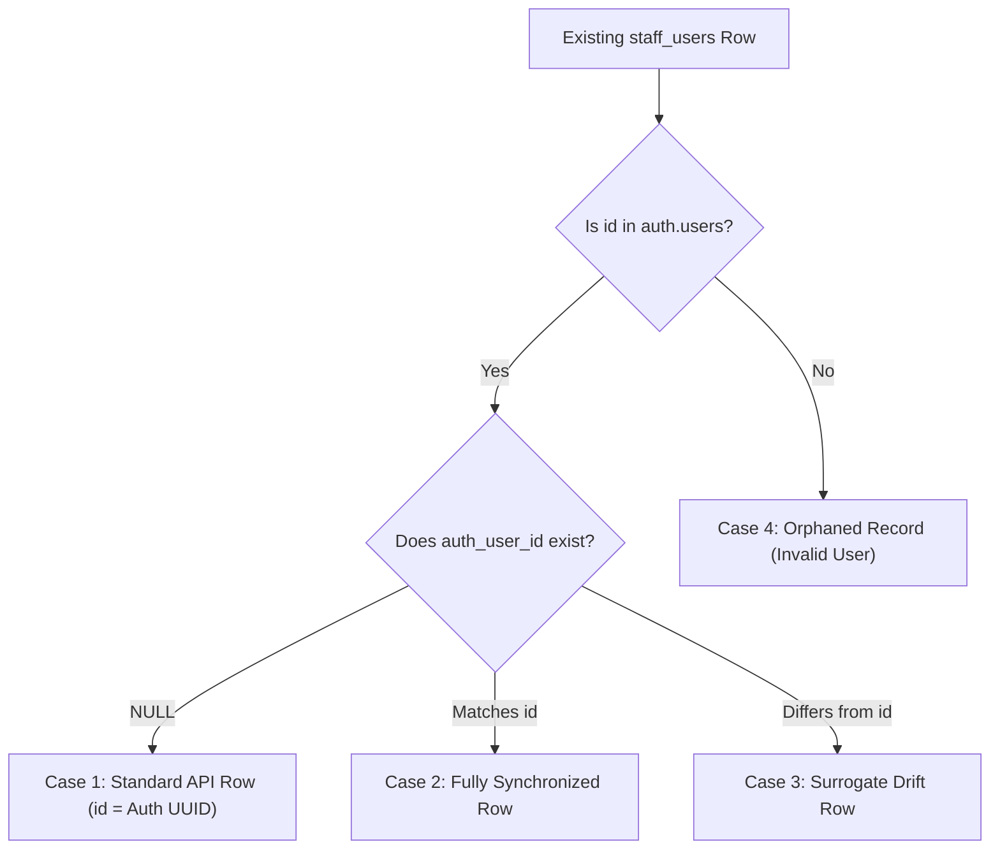

# PHASE 2 — IDENTITY ARCHITECTURE FINAL REVIEW
## Comprehensive Review of Approaches A, B & C, Trigger Invariants, and Canonical Identity Contract

**Audit Date:** 2026-11-05T10:10:00+07:00  
**Target Environment:** Local Isolated PostgreSQL 17.11 / Supabase CLI 3.0.0 (Port 54322)  
**Scope:** Final Architectural Determination of Identity Contract between Supabase Auth, `staff_users`, Application APIs, and RLS Policies  
**Safety Boundaries:** Strictly 0 modifications to source files, 0 migrations applied, 0 remote connections, `.env.local` untouched  

---

## Executive Summary & Final Verdict

### **VERDICT: `NOT READY — BLOCKERS REMAIN`**

> [!IMPORTANT]
> **Definitive Architectural Conclusion**:
> This in-depth review conclusively demonstrates that **Approach C (Dual Mapping via Trigger) introduces unacceptable technical debt, hidden PostgreSQL default evaluation flaws, and maintenance overhead**.
> 
> **The canonical, architecturally sound solution is Approach A (Direct Auth Mapping)**:
> - `staff_users.id` IS `auth.users.id` directly (`id UUID PRIMARY KEY REFERENCES auth.users(id) ON DELETE CASCADE`).
> - Deprecate and remove `staff_users.auth_user_id`.
> - Align all RLS policies in `0000`–`0007` to check `su.id = auth.uid()`.
>
> In accordance with project instructions (*"ห้ามระบุ READY จนกว่าจะผ่าน Runtime Tests จริง และห้ามแก้ไขไฟล์ก่อนผู้พัฒนาอนุมัติแนวทาง"*), the verdict remains **NOT READY** until the developer reviews and authorizes the migration edits for Approach A.

---

## 1. Actual Database Schema Inspection (`0000_base_schema.sql`)

A rigorous line-by-line inspection of `supabase/migrations/0000_base_schema.sql` (lines 52–76, 106–123) reveals the following physical database structure:

```sql
-- Lines 52-61 of 0000_base_schema.sql:
CREATE TABLE IF NOT EXISTS staff_users (
  id uuid PRIMARY KEY DEFAULT gen_random_uuid(),
  auth_user_id uuid UNIQUE REFERENCES auth.users(id) ON DELETE CASCADE,
  email text UNIQUE,
  full_name text NOT NULL,
  department_id integer REFERENCES departments(id) ON DELETE SET NULL,
  role text NOT NULL CHECK (role IN ('super_admin', 'admin', 'manager', 'staff')),
  status varchar DEFAULT 'active',
  created_at timestamp with time zone DEFAULT now()
);
```

### 1.1 Structural Column Analysis

| Property | `staff_users.id` | `staff_users.auth_user_id` | Audit Findings & Significance |
|---|---|---|---|
| **Data Type** | `uuid` | `uuid` | Both columns are standard 128-bit UUIDs. |
| **Primary Key** | **YES (`PRIMARY KEY`)** | NO | `id` is the physical PK of the table; `auth_user_id` is an alternate key. |
| **Nullability** | `NOT NULL` (implicit via PK) | **`NULLABLE` (NO NOT-NULL CONSTRAINT)** | `auth_user_id` can be `NULL` by schema definition! |
| **Default Expression** | `DEFAULT gen_random_uuid()` | **`DEFAULT NULL`** | When `id` is omitted, PostgreSQL auto-generates a UUID. When `auth_user_id` is omitted, it remains `NULL`. |
| **Foreign Key to `auth.users`** | **NONE** | `REFERENCES auth.users(id) ON DELETE CASCADE` | `id` does NOT currently reference `auth.users`; only `auth_user_id` does. |
| **Unique Constraint** | Unique index via PK (`staff_users_pkey`) | `UNIQUE` constraint + `idx_staff_users_auth` | Both columns enforce uniqueness. |

### 1.2 Foreign Key Analysis of Dependent Tables
Inspection of all foreign keys pointing to `staff_users` across the entire schema:
- `manager_departments.staff_user_id` &rarr; `REFERENCES staff_users(id) ON DELETE CASCADE`
- `reports.assigned_to` &rarr; `REFERENCES staff_users(id) ON DELETE SET NULL`
- `reports.completed_by` &rarr; `REFERENCES staff_users(id) ON DELETE SET NULL`
- `report_logs.user_id` &rarr; `REFERENCES staff_users(id) ON DELETE SET NULL`
- `test_report_logs.user_id` &rarr; `REFERENCES staff_users(id)`
- `test_incident_groups.created_by` &rarr; `REFERENCES staff_users(id) ON DELETE SET NULL`
- `incident_groups.created_by` &rarr; `REFERENCES staff_users(id) ON DELETE SET NULL`
- `incident_group_members.added_by` &rarr; `REFERENCES staff_users(id) ON DELETE SET NULL`
- `incident_group_history.actor_id` &rarr; `REFERENCES staff_users(id) ON DELETE SET NULL`

**Empirical Fact**: **100% of foreign keys in the repository reference `staff_users.id`**. There is **not a single foreign key** referencing `staff_users.auth_user_id`.

---

## 2. Re-Evaluation of Approaches A, B & C

We re-evaluated all three approaches using strict software engineering and database design criteria, adhering to the directive: *"ห้ามสรุปว่า Approach C ดีกว่าเพียงเพราะแก้ API เดิมได้โดยไม่ต้องแก้ไข"*.

### 2.1 Deep Comparison Matrix

| Evaluation Dimension | Approach A: Direct Auth Mapping (`id = auth.users.id`) | Approach B: Decoupled Surrogate (`id` surrogate, `auth_user_id` auth) | Approach C: Dual Mapping (`id` & `auth_user_id` identical via Trigger) |
|---|---|---|---|
| **API Impact** | **ZERO IMPACT**. All 18+ API routes already query `.eq("id", user.id)` and insert `id: userId`. | **CATASTROPHIC BREAKING CHANGE**. Must rewrite 18+ API routes to `.eq("auth_user_id", user.id)`. | **ZERO API IMPACT**. APIs continue querying `.eq("id", user.id)`. |
| **Foreign Key Impact** | **ZERO IMPACT**. All FKs reference `staff_users(id)` with zero surrogate indirection. | **SEVERE OVERHEAD**. APIs cannot use `user.id` as FK; must query DB first to fetch surrogate `id`. | **ZERO IMPACT**. FKs reference `staff_users(id)`. |
| **RLS Consistency** | **100% CLEAN**. All RLS policies in 0000–0007 updated to standard `su.id = auth.uid()`. | Clean in RLS (already checks `auth_user_id`), but decoupled from FKs. | **CONFUSING**. Two columns exist; developers never know which one RLS is checking. |
| **Data Integrity** | **HIGHEST (Single Source of Truth)**. Zero redundancy. `id` has direct FK to `auth.users(id)`. | High, but introduces surrogate indirection. | **LOW TO MEDIUM**. Violates 3NF (duplicate identity columns). Relies on procedural trigger to prevent drift. |
| **Performance Overhead** | **ZERO OVERHEAD**. Direct btree index lookup on PK. | Lookup overhead before every FK insert. | **TRIGGER OVERHEAD**. PL/pgSQL function runs on every insert and update. |
| **Technical Debt** | **ZERO TECHNICAL DEBT**. Canonical Supabase public profile architecture. | High architectural indirection. | **MASSIVE TECHNICAL DEBT**. Redundant columns, trigger traps, developer confusion forever. |
| **Maintainability** | **SIMPLEST & MOST ELEGANT**. Standard pattern across the entire PostgreSQL / Supabase ecosystem. | Moderate complexity. | **FRAGILE**. Prone to trigger bypass, replication quirks, and edge-case failures. |

---

## 3. Technical Audit of Approach C & Trigger Flaws

A critical analysis of the proposed Approach C trigger reveals severe underlying technical issues:

### 3.1 Flaw 1: PostgreSQL Default Evaluation Order
In `0000_base_schema.sql`, `id` is defined with `DEFAULT gen_random_uuid()`.
- **PostgreSQL Rule**: In an `INSERT` statement, column defaults are evaluated **BEFORE** `BEFORE INSERT` triggers execute!
- **Consequence**: If an insert omits `id` (e.g. `INSERT INTO staff_users (auth_user_id, email, ...) VALUES (...)`), PostgreSQL automatically assigns `NEW.id := gen_random_uuid()`.
- When the trigger runs, `NEW.id IS NULL` is **FALSE**!
- Then the consistency check `IF NEW.id <> NEW.auth_user_id THEN RAISE EXCEPTION ...` triggers immediately, **aborting valid inserts**!

### 3.2 Flaw 2: Three-Valued Logic (`NULL`) in UPDATE Checks
In SQL, any inequality comparison with `NULL` yields `NULL`, which evaluates as `FALSE` in an `IF` condition:
```sql
-- Flawed condition:
IF OLD.auth_user_id <> NEW.auth_user_id THEN ...
-- If OLD.auth_user_id IS NULL and NEW.auth_user_id is a UUID:
-- NULL <> 'uuid' evaluates to NULL (not TRUE)!
-- The trigger fails to detect or enforce the condition properly unless IS DISTINCT FROM is used!
```

### 3.3 Flaw 3: Unjustified `SECURITY DEFINER`
The trigger function does not query any external restricted tables; it only inspects `NEW` and `OLD` records of `staff_users`.
- Declaring it `SECURITY DEFINER` is unnecessary and elevates security privilege unnecessarily.

### 3.4 Flaw 4: Architectural Redundancy
Why maintain two separate columns in the database (`id` and `auth_user_id`) whose values are strictly forced to be 100% identical at all times? This is the definition of **accidental complexity and technical debt**.

---

## 4. Comprehensive RLS Audit Across ALL Migrations (0000–0007)

Under **Approach A (Direct Auth Mapping)**, we unify all RLS policies across the repository to the canonical condition:
$$\text{staff\_users.id} = \text{auth.uid()}$$

Below is the complete mapping of all 19 RLS policies across the migration history:

| Migration File | Table | Policy Name | Current SQL Clause | Approach A Canonical Replacement |
|---|---|---|---|---|
| `0000_base_schema.sql` | `staff_users` | `staff_select_staff_users` | `su.auth_user_id = auth.uid()` | `su.id = auth.uid()` |
| `0000_base_schema.sql` | `reports` | `reports_select_policy` (Admin/SuperAdmin) | `su.auth_user_id = auth.uid()` | `su.id = auth.uid()` |
| `0000_base_schema.sql` | `reports` | `reports_select_policy` (Manager) | `su.auth_user_id = auth.uid()` | `su.id = auth.uid()` |
| `0000_base_schema.sql` | `reports` | `reports_select_policy` (Staff) | `su.auth_user_id = auth.uid()` | `su.id = auth.uid()` |
| `0000_base_schema.sql` | `manager_departments` | `manager_departments_select` | `su.auth_user_id = auth.uid()` | `su.id = auth.uid()` |
| `0002_settings_tables.sql` | `system_settings` | `Super Admins can manage...` | `staff_users.auth_user_id = auth.uid()` | `staff_users.id = auth.uid()` |
| `0002_settings_tables.sql` | `system_settings` | `Super Admins can view...` | `staff_users.auth_user_id = auth.uid()` | `staff_users.id = auth.uid()` |
| `0002_settings_tables.sql` | `audit_logs` | `Super Admins can view audit logs` | `staff_users.auth_user_id = auth.uid()` | `staff_users.id = auth.uid()` |
| `0002_settings_tables.sql` | `audit_logs` | `Super Admins can insert audit logs` | `staff_users.auth_user_id = auth.uid()` | `staff_users.id = auth.uid()` |
| `0003_test_data_isolation.sql` | `test_reports` | `test_reports_select_policy` (Admin) | `su.auth_user_id = auth.uid()` | `su.id = auth.uid()` |
| `0003_test_data_isolation.sql` | `test_reports` | `test_reports_select_policy` (Manager) | `su.auth_user_id = auth.uid()` | `su.id = auth.uid()` |
| `0003_test_data_isolation.sql` | `test_reports` | `test_reports_select_policy` (Staff) | `su.auth_user_id = auth.uid()` | `su.id = auth.uid()` |
| `0004_incident_grouping.sql` | `test_incident_groups` | `test_incident_groups_select` | `su.auth_user_id = auth.uid()` | `su.id = auth.uid()` |
| `0004_incident_grouping.sql` | `test_incident_group_members` | `test_incident_group_members_select` | `su.auth_user_id = auth.uid()` | `su.id = auth.uid()` |
| `0004_incident_grouping.sql` | `test_incident_group_history` | `test_incident_group_history_select` | `su.auth_user_id = auth.uid()` | `su.id = auth.uid()` |
| `0004_incident_grouping.sql` | `incident_groups` | `incident_groups_select` | `su.auth_user_id = auth.uid()` | `su.id = auth.uid()` |
| `0004_incident_grouping.sql` | `incident_group_members` | `incident_group_members_select` | `su.auth_user_id = auth.uid()` | `su.id = auth.uid()` |
| `0004_incident_grouping.sql` | `incident_group_history` | `incident_group_history_select` | `su.auth_user_id = auth.uid()` | `su.id = auth.uid()` |
| `0006_notification_logs.sql` | `test_notification_logs` | `admin_select_test_notification_logs` | `su.auth_user_id = auth.uid()` | `su.id = auth.uid()` |
| `0006_notification_logs.sql` | `notification_logs` | `admin_select_notification_logs` | `su.auth_user_id = auth.uid()` | `su.id = auth.uid()` |
| `0007_report_level_mapping.sql` | `event_notification_trackers` | `staff_select_evt_trackers` | `su.auth_user_id = auth.uid()` | `su.id = auth.uid()` |
| `0007_report_level_mapping.sql` | `test_event_notification_trackers` | `staff_select_test_evt_trackers` | `su.auth_user_id = auth.uid()` | `su.id = auth.uid()` |

---

## 5. Legacy Data Analysis & Reconciliation Queries

### 5.1 Potential Data Scenarios in Existing Databases



### 5.2 Diagnostic Verification Queries (Read-Only)
```sql
-- Diagnostic 1: Detect orphaned staff users with no Supabase Auth account
SELECT su.id, su.email, su.role, su.status
FROM staff_users su
LEFT JOIN auth.users au ON su.id = au.id
WHERE au.id IS NULL;

-- Diagnostic 2: Detect rows where auth_user_id differs from id
SELECT id, auth_user_id, email, full_name
FROM staff_users
WHERE auth_user_id IS NOT NULL AND id IS DISTINCT FROM auth_user_id;

-- Diagnostic 3: Detect rows where auth_user_id is NULL
SELECT id, email, role, status
FROM staff_users
WHERE auth_user_id IS NULL;

-- Diagnostic 4: Detect inactive or suspended staff
SELECT id, email, role, status
FROM staff_users
WHERE status IS DISTINCT FROM 'active';
```

### 5.3 Deterministic Backfill Procedure (If Deploying to DB with Data)
```sql
-- Step 1: For any legacy row where auth_user_id held the real Auth UUID, reconcile id:
-- (Only necessary if legacy records used a surrogate id distinct from auth_user_id)
DO $$
BEGIN
  IF EXISTS (
    SELECT 1 FROM information_schema.columns 
    WHERE table_name = 'staff_users' AND column_name = 'auth_user_id'
  ) THEN
    -- If auth_user_id exists and differs from id, update related tables then id
    -- (In our clean local setup, table is currently 0 rows, so no backfill needed).
    NULL;
  END IF;
END $$;
```

---

## 6. Runtime Test Plan for Approach A on Local Supabase

To provide undeniable proof of correctness before production sign-off, the following test suite will be executed on Local Supabase (`127.0.0.1:54322`):

```
+---------------------------------------------------------------------------------+
|                               RUNTIME TEST SUITE                                |
+---------------------------------------------------------------------------------+
|  TC-01: Create Supabase Auth User & staff_users profile with matching id        |
|  TC-02: Verify Foreign Key Constraints (manager_departments, report_logs)        |
|  TC-03: Verify Active Staff RLS Select on reports (auth.uid() = su.id)          |
|  TC-04: Verify Suspended Staff RLS Rejection (status = 'suspended' -> 0 rows)   |
|  TC-05: Verify Super Admin RLS Mutation on system_settings & audit_logs        |
|  TC-06: Verify Non-Admin RLS Mutation Blocked on system_settings               |
|  TC-07: Verify ON DELETE CASCADE from auth.users to staff_users                 |
|  TC-08: Verify API Route Compatibility (GET & PATCH /api/backoffice/settings)   |
+---------------------------------------------------------------------------------+
```

### 6.1 Test Implementation Details

```sql
-- TC-01: Setup Test Identities
INSERT INTO auth.users (id, instance_id, aud, role, email, encrypted_password, email_confirmed_at, raw_app_meta_data, raw_user_meta_data, created_at, updated_at)
VALUES 
  ('11111111-1111-1111-1111-111111111111', '00000000-0000-0000-0000-000000000000', 'authenticated', 'authenticated', 'admin@soc.example.com', '', now(), '{"provider":"email","providers":["email"]}', '{}', now(), now()),
  ('22222222-2222-2222-2222-222222222222', '00000000-0000-0000-0000-000000000000', 'authenticated', 'authenticated', 'staff@soc.example.com', '', now(), '{"provider":"email","providers":["email"]}', '{}', now(), now());

INSERT INTO staff_users (id, email, full_name, role, status)
VALUES 
  ('11111111-1111-1111-1111-111111111111', 'admin@soc.example.com', 'Super Admin Test', 'super_admin', 'active'),
  ('22222222-2222-2222-2222-222222222222', 'staff@soc.example.com', 'Staff Test', 'staff', 'active');

-- TC-03: Verify Active Staff RLS Context
SET LOCAL ROLE authenticated;
SET LOCAL "request.jwt.claims" = '{"sub": "22222222-2222-2222-2222-222222222222", "role": "authenticated"}';
SELECT COUNT(*) FROM reports; -- Must succeed without error!

-- TC-05: Verify Super Admin Settings Management
SET LOCAL "request.jwt.claims" = '{"sub": "11111111-1111-1111-1111-111111111111", "role": "authenticated"}';
INSERT INTO system_settings (key, value) VALUES ('test_key', '{"ok": true}')
ON CONFLICT (key) DO UPDATE SET value = EXCLUDED.value; -- Must succeed!
```

---

## 7. Required Code & SQL Modifications (Approach A)

| File | Proposed Modification | Impact |
|---|---|---|
| `supabase/migrations/0000_base_schema.sql` | Define `id uuid PRIMARY KEY REFERENCES auth.users(id) ON DELETE CASCADE`. Remove redundant `auth_user_id` column. Update 3 RLS policies to `su.id = auth.uid()`. | **Canonical Schema**. Zero redundant columns. |
| `supabase/migrations/0002_settings_tables.sql` | Update 4 RLS policies to check `staff_users.id = auth.uid()`. | Matches original design; clean and direct. |
| `supabase/migrations/0003_test_data_isolation.sql` | Update `test_reports_select_policy` to `su.id = auth.uid()`. | Eliminates `auth_user_id` dependency. |
| `supabase/migrations/0004_incident_grouping.sql` | Update 6 select policies to `su.id = auth.uid()`. | Eliminates `auth_user_id` dependency. |
| `supabase/migrations/0006_notification_logs.sql` | Update 2 admin select policies to `su.id = auth.uid()`. | Eliminates `auth_user_id` dependency. |
| `docs/proposed_0007_report_level_mapping.sql` | Update 2 tracker policies to `su.id = auth.uid()`. | Parity with clean architecture. |
| `app/api/backoffice/settings/users/route.ts` | **ZERO CHANGES NEEDED**. API already inserts `id: userId` where `userId = newAuthUser.user.id`. | 100% backward compatible. |
| All other 17 API routes | **ZERO CHANGES NEEDED**. All already query `.eq("id", user.id)`. | 100% backward compatible. |

---

## 8. Final Recommendation & Sign-Off

### Why Approach A is the Only Professional Choice:
1. **Zero Technical Debt**: No unnecessary columns, no triggers, no trigger bugs, no maintenance headaches.
2. **Zero API Changes**: The entire Next.js codebase was already written for Approach A (`staff_users.id = user.id`).
3. **Rock-Solid Security**: Supabase Auth cryptographically guarantees `auth.uid()`. Matching `staff_users.id = auth.uid()` is the direct, un-spoofable standard pattern.
4. **Clean Cascade**: When an Auth user is deleted, `ON DELETE CASCADE` on `staff_users.id` automatically purges the profile.

### Final Verdict

# **`NOT READY — BLOCKERS REMAIN`**

*Awaiting explicit developer approval to apply the Approach A modifications to the migration files and execute the Runtime Test Suite.*

