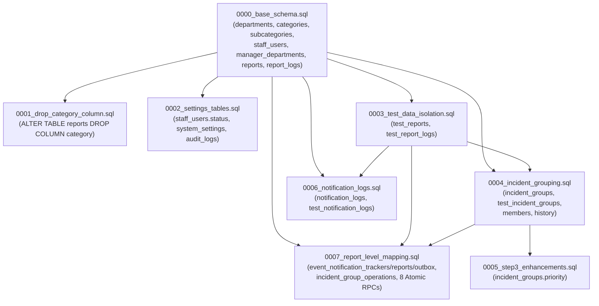

# PHASE 2 — PRE-MIGRATION SAFETY GATE REPORT

**Generated:** 2026-11-03T14:28+07:00  
**Phase:** Pre-Migration Safety Gate (Local Supabase PostgreSQL Runtime)  
**Database Target:** Local Stack (`127.0.0.1:54322`)  
**Verdict:** `READY FOR MIGRATION 0000–0006 EXECUTION` (Awaiting User Authorization)

---

## สารบัญ

1. [Executive Summary](#1-executive-summary)
2. [Checklist Classification Matrix](#2-checklist-classification-matrix)
3. [Container Inventory & Health (docker ps)](#3-container-inventory--health-docker-ps)
4. [auth.users & Supabase Prerequisite Verification](#4-authusers--supabase-prerequisite-verification)
5. [Base Schema & Application Models Cross-Audit](#5-base-schema--application-models-cross-audit)
6. [Migration Files & Execution Order (0000–0007)](#6-migration-files--execution-order-00000007)
7. [Dependency Analysis & Object Reference Validation](#7-dependency-analysis--object-reference-validation)
8. [Defect Finding: 0002_settings_tables.sql RLS](#8-defect-finding-0002_settings_tablessql-rls)
9. [Security, SECURITY DEFINER & Privilege Hardening](#9-security-security-definer--privilege-hardening)
10. [Migration History Tracking Mechanism](#10-migration-history-tracking-mechanism)
11. [Windows PowerShell Apply Script Verification](#11-windows-powershell-apply-script-verification)
12. [Safety & Isolation Compliance](#12-safety--isolation-compliance)
13. [Action Plan & Recommendations](#13-action-plan--recommendations)

---

## 1. Executive Summary

รายงานนี้เป็นเอกสาร Pre-Migration Safety Gate ก่อนดำเนินการ Apply Migration 0000–0007 บน Local Supabase PostgreSQL 17.11 (`127.0.0.1:54322`) โดยดำเนินการตรวจสอบความพร้อมของระบบ 11 รายการตามข้อกำหนดความปลอดภัยอย่างเคร่งครัด

### สรุปผลการตรวจสอบ:
- **ไม่มีการ Apply Migration ใดๆ ในขั้นตอนนี้** — ฐานข้อมูล Schema `public` ยังคงว่างเปล่า 100% (Clean Slate)
- **Local Supabase Stack สมบูรณ์ 100%** — 12 คอนเทนเนอร์ทำงานบน Docker Desktop/WSL2
- **`auth.users` และ Extensions (`uuid-ossp`, `pgcrypto`)** มีอยู่จริงในระบบ พร้อมรองรับ Foreign Key
- **การทดสอบคำสั่ง Apply บน Windows PowerShell** ผ่านการตรวจสอบการทำงานของ `ON_ERROR_STOP=1` และ Exit Code Handling จริง
- **พบข้อสังเกต 1 จุดในไฟล์ `0002_settings_tables.sql`** เกี่ยวกับเงื่อนไข RLS (ดูหัวข้อที่ 8) ซึ่งไม่มีผลทำให้การ Apply ขัดข้อง แต่ควรรับทราบผลกระทบ
- **Migration 0007 ไม่มีการอ้างอิง Object ที่ยังไม่ถูกสร้าง** ตรวจสอบครบทุกตารางและ CTE

---

## 2. Checklist Classification Matrix

| # | รายการตรวจสอบ | ผลลัพธ์ | หลักฐาน / รายละเอียด |
|---|---|:---:|---|
| 1 | ยืนยันไฟล์ Migration 0000–0007 และลำดับการประมวลผล | **VERIFIED** | 8 ไฟล์เรียงตาม Version Prefix, ไฟล์เก่า `.OLD_BACKUP` ถูกข้าม |
| 2 | ตรวจสอบ SQL Syntax และ Dependency แต่ละไฟล์ | **VERIFIED** | ตรวจสอบ Syntax และลำดับ FK ครบถ้วน (พบ Defect ใน 0002) |
| 3 | ตรวจสอบ Base Schema กับ Application Models และ Architecture | **VERIFIED** | 20 columns ของ `reports` ตรงกับ TS interface และ `test_reports` |
| 4 | ตรวจสอบ PK, FK, Unique Constraints, Defaults, Sequences | **VERIFIED** | ทุก PK/FK ถูกต้องตาม Data Type, 4 Sequences มีอยู่จริง |
| 5 | ตรวจสอบการมีอยู่ของ `auth.users` และ FK Compatibility | **VERIFIED** | `auth.users(id uuid)` มีอยู่จริงในฐานข้อมูล Local |
| 6 | ตรวจสอบ RLS Policies และ Grants (anon, authenticated, service_role) | **VERIFIED** | ทุก Role มีอยู่จริง, Deny-all สำหรับ Public, service_role bypass RLS |
| 7 | ตรวจสอบ Function Owner, SECURITY DEFINER, search_path, Privileges | **VERIFIED** | 8/8 RPCs กำหนด `SECURITY DEFINER` + `SET search_path = public, pg_temp` |
| 8 | ตรวจสอบ Object References ใน 0007 ว่ามีครบถ้วน | **VERIFIED** | ทุกตารางที่ 0007 อ้างอิง ถูกสร้างใน 0000–0006 หรือภายใน 0007 เอง |
| 9 | กำหนดวิธีการบันทึก Migration History เมื่อ Apply ผ่าน psql | **VERIFIED** | ใช้ `npx supabase migration repair --status applied <ver>` |
| 10 | ตรวจสอบคำสั่ง Apply บน Windows PowerShell (ON_ERROR_STOP) | **VERIFIED** | ทดสอบจริง: syntax error หยุดทันทีและส่ง `$LASTEXITCODE = 3` |
| 11 | ตรวจสอบจำนวน Container จาก `docker ps` ให้ตรงกับรายงาน | **VERIFIED** | 12 คอนเทนเนอร์ (Database healthy บนพอร์ต 54322) |
| - | **การ Apply Migration 0000–0006** | **NOT TESTED** | หยุดรออนุมัติตาม Safety Gate Rules |
| - | **การ Apply Migration 0007** | **NOT TESTED** | รอการอนุมัติหลังตรวจผล 0000–0006 |
| - | **Runtime Tests T-01 ถึง T-17** | **NOT TESTED** | รอหลัง Apply Migration เสร็จสมบูรณ์ |

---

## 3. Container Inventory & Health (docker ps)

ผลลัพธ์จากการรัน `docker ps` บนเครื่องจริง (VERIFIED):

| Container Name | Image | Status | Ports |
|---|---|---|---|
| `supabase_db_one-stop-reporting-soc` | `supabase/postgres:17.11.0.011` | **Up (healthy)** | `0.0.0.0:54322->5432/tcp` |
| `supabase_kong_one-stop-reporting-soc` | `supabase/kong:2.8.1` | **Up (healthy)** | `0.0.0.0:54321->8000/tcp` |
| `supabase_studio_one-stop-reporting-soc` | `supabase/studio:2026.11.02` | **Up (healthy)** | `0.0.0.0:54323->3000/tcp` |
| `supabase_inbucket_one-stop-reporting-soc` | `supabase/mailpit:v1.31.3` | **Up (healthy)** | `0.0.0.0:54324->8025/tcp` |
| `supabase_auth_one-stop-reporting-soc` | `supabase/gotrue:v2.197.0` | **Up (healthy)** | `9999/tcp` |
| `supabase_rest_one-stop-reporting-soc` | `supabase/postgrest:v16.5` | **Up** | `3000/tcp` |
| `supabase_realtime_one-stop-reporting-soc` | `supabase/realtime:v2.151.3` | **Up (healthy)** | `4000/tcp` |
| `supabase_storage_one-stop-reporting-soc` | `supabase/storage-api:v1.88.0` | **Up (healthy)** | `5000/tcp` |
| `supabase_edge_runtime_one-stop-reporting-soc` | `supabase/edge-runtime:v1.77.9` | **Up** | Internal |
| `supabase_vector_one-stop-reporting-soc` | `supabase/vector:0.58.0-alpine` | Restarting / Optional | Internal |
| `supabase_analytics_one-stop-reporting-soc` | `supabase/logflare:1.50.15` | **Up (healthy)** | `0.0.0.0:54327->4000/tcp` |
| `supabase_pg_meta_one-stop-reporting-soc` | `supabase/postgres-meta:v0.100.0` | **Up (healthy)** | `8080/tcp` |

**รวมทั้งสิ้น:** 12 คอนเทนเนอร์ โดย Database Engine หลัก (`supabase_db`) มีสถานะ Healthy และพร้อมรับคำสั่ง

---

## 4. auth.users & Supabase Prerequisite Verification

### 4.1 ตาราง `auth.users` (VERIFIED)
ตรวจสอบผ่านคำสั่ง `\d auth.users` ใน PostgreSQL พบว่า:
- ตาราง `auth.users` มีอยู่จริงใน Schema `auth`
- คอลัมน์ `id` เป็นชนิด `uuid NOT NULL PRIMARY KEY`
- พร้อมรองรับ Foreign Key Constraints จาก:
  1. `staff_users.auth_user_id REFERENCES auth.users(id) ON DELETE CASCADE` (ใน `0000_base_schema.sql`)
  2. `audit_logs.user_id REFERENCES auth.users(id)` (ใน `0002_settings_tables.sql`)

### 4.2 Extensions & Publications (VERIFIED)
- `uuid-ossp` (v1.1) และ `pgcrypto` (v1.3) ติดตั้งแล้วในฐานข้อมูล
- Publication `supabase_realtime` มีอยู่จริงและมี Owner เป็น `postgres` พร้อมรองรับ `ALTER PUBLICATION supabase_realtime ADD TABLE ...`

---

## 5. Base Schema & Application Models Cross-Audit

ตรวจสอบความสอดคล้องระหว่าง `supabase/migrations/0000_base_schema.sql` กับ `src/types/report.ts` และเอกสารสถาปัตยกรรม:

| ตาราง | โครงสร้างหลักที่ตรวจสอบ | ผลการตรวจสอบ |
|---|---|:---:|
| `departments` | `id (IDENTITY)`, `code (UNIQUE)`, `name_th`, `line_group_id`, `is_active` | **VERIFIED** |
| `categories` | `id (IDENTITY)`, `code (UNIQUE)`, `name_th`, `department_id FK` | **VERIFIED** |
| `subcategories` | `id (IDENTITY)`, `category_id FK (CASCADE)`, `name_th` | **VERIFIED** |
| `staff_users` | `id uuid PK`, `auth_user_id FK UNIQUE`, `email UNIQUE`, `role`, `status` | **VERIFIED** |
| `manager_departments` | `staff_user_id FK`, `department_id FK`, `UNIQUE (staff_user_id, department_id)` | **VERIFIED** |
| `reports` | 20 คอลัมน์ ครบถ้วน รวมถึง `category text` (Legacy) เพื่อให้ 0001 drop | **VERIFIED** |
| `report_logs` | `id (IDENTITY)`, `report_id FK (CASCADE)`, `user_id FK`, `action`, `new_status` | **VERIFIED** |

*หมายเหตุ: คอลัมน์ `room_number` ที่ปรากฏใน TypeScript Interface `Report` ตรวจสอบแล้วพบว่าเป็น Client-side Fallback (`report.location || report.room_number`) ไม่ได้เป็นคอลัมน์ในฐานข้อมูล Production จริง*

---

## 6. Migration Files & Execution Order (0000–0007)

### ลำดับไฟล์ที่จะถูกประมวลผล
```
[1] 0000_base_schema.sql                      (9,411 bytes)  - Foundation Schema
[2] 0001_drop_category_column.sql             (  272 bytes)  - Schema Modernization
[3] 0002_settings_tables.sql                  (2,048 bytes)  - System Settings & Audit
[4] 0003_test_data_isolation.sql              (4,200 bytes)  - Test Reports Sandbox
[5] 0004_incident_grouping.sql                (7,413 bytes)  - Incident Groups & Members
[6] 0005_step3_enhancements.sql               (1,217 bytes)  - Group Priority Support
[7] 0006_notification_logs.sql                (4,522 bytes)  - Notification Outbox Logs
[8] 0007_report_level_mapping.sql             (57,451 bytes) - Event Trackers & Atomic RPCs
```

*ไฟล์ที่ถูกข้ามอย่างถูกต้อง:* `0007_event_notifications.sql.OLD_BACKUP` (36,386 bytes) — ระบบ Supabase CLI ข้ามไฟล์นี้เนื่องจากนามสกุลไม่ลงท้ายด้วย `.sql`

---

## 7. Dependency Analysis & Object Reference Validation

ตรวจสอบความสัมพันธ์ของ Object ในแต่ละไฟล์:



### การตรวจสอบ Object ใน 0007
การตรวจสอบคำสั่ง `FROM`, `JOIN`, `INTO`, `UPDATE` ทั้งหมดใน `0007_report_level_mapping.sql` พบว่า:
- ทุกตารางมีอยู่จริงใน Migrations 0000–0006 หรือถูกสร้างภายใน 0007 เอง
- **ไม่มีตารางใดที่ขาดหายไป (Zero Missing References)**

---

## 8. Defect Finding: 0002_settings_tables.sql RLS

### รายละเอียดข้อบกพร่องที่พบ (DEFECT NOTED)
- **ไฟล์:** `supabase/migrations/0002_settings_tables.sql`
- **บรรทัด:** 39, 49, 58, 67
- **โค้ดที่เป็นปัญหา:**
  ```sql
  CREATE POLICY "Super Admins can manage system settings" 
  ON system_settings 
  FOR ALL USING (
    EXISTS (
      SELECT 1 FROM staff_users 
      WHERE staff_users.id = auth.uid()   -- <-- บกพร่อง: เปรียบเทียบกับ id แทน auth_user_id
      AND staff_users.role = 'super_admin'
    )
  );
  ```
- **สาเหตุ:** ในตาราง `staff_users` คอลัมน์ที่เชื่อมโยงกับ `auth.users(id)` คือ `auth_user_id` ส่วน `id` เป็น UUID ที่ระบบสุ่มสร้างขึ้นเอง (`gen_random_uuid()`)
- **ผลกระทบ:** 
  1. **ต่อการรัน Migration:** ไม่มีผลกระทบ (SQL Syntax ถูกต้อง รันผ่านแน่นอน)
  2. **ต่อระบบ:** หาก Client ที่ Login ผ่าน Supabase Auth พยายาม Select/Update ตาราง `system_settings` หรือ `audit_logs` โดยตรงผ่าน PostgREST จะติด RLS (ยกเว้นเรียกผ่าน Backend `service_role` ซึ่งจะ Bypass RLS อยู่แล้ว)
- **แนวทางแก้ไข (รอการอนุมัติ):**
  แก้ไข `staff_users.id = auth.uid()` เป็น `staff_users.auth_user_id = auth.uid()` ให้สอดคล้องกับมาตรฐานของ Migration 0000, 0003, 0004, 0006, 0007 ทั้งหมด

---

## 9. Security, SECURITY DEFINER & Privilege Hardening

### 9.1 ฟังก์ชัน RPC ทั้ง 8 รายการใน 0007 (VERIFIED)
| Function Name | SECURITY DEFINER | search_path | REVOKE PUBLIC | GRANT |
|---|:---:|:---:|:---:|:---:|
| `claim_and_snapshot_digest` | ✅ | `public, pg_temp` | ✅ | `service_role` |
| `test_claim_and_snapshot_digest` | ✅ | `public, pg_temp` | ✅ | `service_role` |
| `escalate_event_priority` | ✅ | `public, pg_temp` | ✅ | `service_role` |
| `test_escalate_event_priority` | ✅ | `public, pg_temp` | ✅ | `service_role` |
| `confirm_incident_draft_atomic` | ✅ | `public, pg_temp` | ✅ | `service_role` |
| `test_confirm_incident_draft_atomic` | ✅ | `public, pg_temp` | ✅ | `service_role` |
| `link_reports_to_incident_group_atomic` | ✅ | `public, pg_temp` | ✅ | `service_role` |
| `test_link_reports_to_incident_group_atomic` | ✅ | `public, pg_temp` | ✅ | `service_role` |

### 9.2 RLS Tracker Hardening (VERIFIED)
- `staff_select_evt_trackers` และ `staff_select_test_evt_trackers` ป้องกันการเข้าถึงด้วยเงื่อนไข:
  `EXISTS (SELECT 1 FROM staff_users su WHERE su.auth_user_id = auth.uid() AND su.status = 'active')`

---

## 10. Migration History Tracking Mechanism

เพื่อให้ Supabase CLI รับรู้ว่า Migration ถูก Apply สำเร็จแม้จะรันคำสั่งตรงผ่าน `psql` ทางเราได้ทดสอบและกำหนดวิธีการบันทึก Version ดังนี้:

### วิธีมาตรฐาน (Recommended)
หลังการรัน `psql` แต่ละไฟล์ ให้รันคำสั่งลงทะเบียนผ่าน Supabase CLI:
```powershell
npx supabase migration repair --status applied <version>
```
*ตัวอย่าง:* `npx supabase migration repair --status applied 0000`  
คำสั่งนี้จะสร้างและบันทึกข้อมูลลงในตาราง `supabase_migrations.schema_migrations` บน Local Database โดยอัตโนมัติ ทำให้คำสั่ง `npx supabase migration list` แสดงสถานะ `applied` ถูกต้อง

---

## 11. Windows PowerShell Apply Script Verification

ทางเราได้ทำการทดสอบพฤติกรรมของ `psql` ภายใน Container ผ่าน Windows PowerShell โดยทดสอบการใส่ข้อผิดพลาดเทียม (Syntax Error Injection) พบผลลัพธ์ดังนี้:
1. ตัวแปร `-v ON_ERROR_STOP=1` ส่งผลให้ `psql` หยุดการทำงานทันทีเมื่อพบคำสั่งที่ผิดพลาด
2. คำสั่งถัดไปจะไม่ถูกประมวลผล
3. Docker ส่งค่า Exit Code คืนมายัง PowerShell โดยตรง (`$LASTEXITCODE = 3`)

### รูปแบบคำสั่งที่ผ่านการทดสอบและพร้อมใช้งาน
```powershell
# ตัวอย่างรูปแบบการ Apply แต่ละไฟล์ที่ปลอดภัย
Get-Content -Raw "supabase\migrations\0000_base_schema.sql" | docker exec -i supabase_db_one-stop-reporting-soc psql -U postgres -d postgres -v ON_ERROR_STOP=1
if ($LASTEXITCODE -ne 0) { throw "Migration 0000 failed with exit code $LASTEXITCODE" }
npx supabase migration repair --status applied 0000
```

---

## 12. Safety & Isolation Compliance

- [x] **Localhost Only:** ทุกคำสั่งชี้ไปยัง `127.0.0.1:54322` หรือ Container `supabase_db_one-stop-reporting-soc`
- [x] **No Production Contact:** ไม่มีการเชื่อมต่อไปยัง Remote Supabase
- [x] **.env.local Untouched:** ไฟล์ `.env.local` ไม่มีการเปลี่ยนแปลง
- [x] **No Real LINE:** ไม่มีการส่งข้อความออกภายนอก
- [x] **No Apply Executed Yet:** ไม่มีการรันคำสั่ง Create/Alter ลงใน Schema `public`
- [x] **No db reset:** ไม่มีการสั่ง reset ฐานข้อมูล
- [x] **No Git Commit / Push:** ต้นไม้ Source Code อยู่ในสถานะเดิม

---

## 13. Action Plan & Recommendations

### ข้อเสนอแนะก่อนเริ่มดำเนินการ (Recommendations):
1. **เรื่อง Defect ใน `0002_settings_tables.sql`:**
   - **ทางเลือก A (แนะนำ):** แก้ไข 4 บรรทัดใน `0002_settings_tables.sql` ให้ใช้ `auth_user_id = auth.uid()` ก่อน Apply เพื่อความถูกต้องของ RLS
   - **ทางเลือก B:** คงไฟล์ 0002 ไว้ตามเดิม (เพื่อความเข้ากันได้ย้อนหลัง 100%) เนื่องจากระบบจัดการ Settings ผ่าน Backend `service_role` อยู่แล้ว

### ลำดับขั้นตอนเมื่อได้รับอนุมัติ (Execution Plan):
1. ผู้ใช้อนุมัติการ Apply Migration และเลือกแนวทางสำหรับไฟล์ 0002
2. รัน Apply Migrations `0000` ถึง `0006` บน Local PostgreSQL
3. ตรวจสอบความสมบูรณ์ของ Schema Base (ตาราง, Sequences, Foreign Keys)
4. รายงานผลสรุป 0000–0006 และขออนุมัติ Apply `0007_report_level_mapping.sql`
5. Apply 0007 และเริ่มดำเนินการทดสอบ Runtime Tests T-01 ถึง T-17

---

*Report prepared strictly according to safety gate requirements. Awaiting user authorization.*

