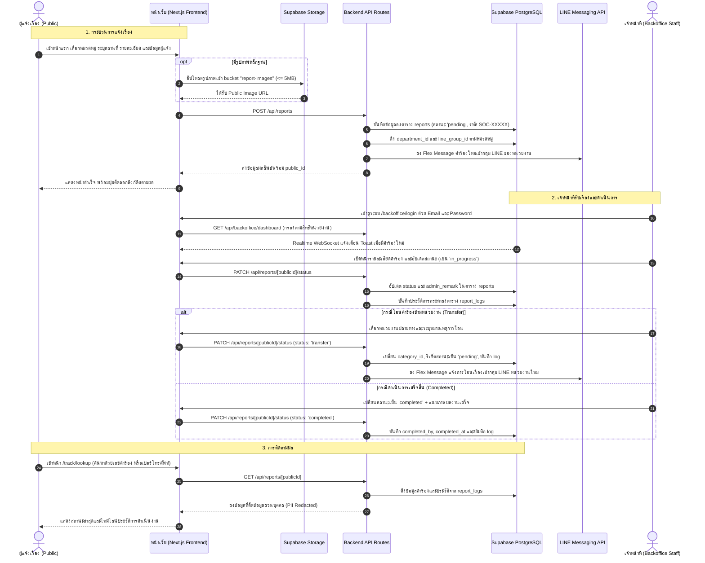
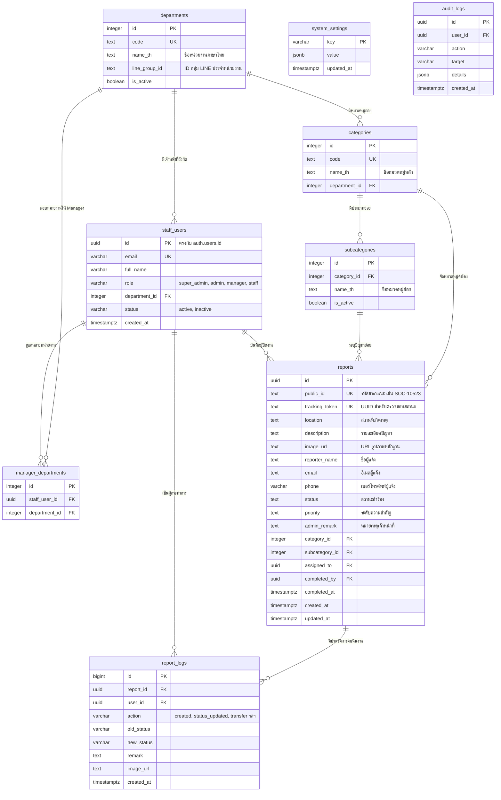

# เอกสารวิเคราะห์ระบบ: One Stop Reporting SOC
## ระบบบริหารจัดการและรับเรื่องร้องเรียนแบบเบ็ดเสร็จ คณะสังคมศาสตร์

> **เอกสารนี้วิเคราะห์และสรุปจาก:** Source Code, Database Schema, API Route, Configuration, Component UI, Test Suites และเอกสารทางเทคนิคที่มีอยู่จริงในโปรเจกต์ ณ ปัจจุบันเท่านั้น (Verified AS-IS Implementation)

---

## สารบัญ
1. [ภาพรวมระบบ (System Overview)](#1-ภาพรวมระบบ-system-overview)
2. [โครงสร้างส่วนประกอบของระบบ (System Components)](#2-โครงสร้างส่วนประกอบของระบบ-system-components)
3. [โครงสร้างและสิทธิ์ผู้ใช้งาน (User Roles & Permissions)](#3-โครงสร้างและสิทธิ์ผู้ใช้งาน-user-roles--permissions)
4. [ขอบเขตความสามารถของระบบ (Functional Scope)](#4-ขอบเขตความสามารถของระบบ-functional-scope)
5. [กระบวนการทำงานหลักของระบบ (Main Workflow)](#5-กระบวนการทำงานหลักของระบบ-main-workflow)
6. [โครงสร้างข้อมูลในฐานข้อมูล (Data Structure)](#6-โครงสร้างข้อมูลในฐานข้อมูล-data-structure)
7. [สถาปัตยกรรมระบบ (System Architecture)](#7-สถาปัตยกรรมระบบ-system-architecture)
8. [การเชื่อมต่อกับระบบภายนอก (External Integrations)](#8-การเชื่อมต่อกับระบบภายนอก-external-integrations)
9. [การยืนยันตัวตนและการรักษาความปลอดภัย (Authentication & Security)](#9-การยืนยันตัวตนและการรักษาความปลอดภัย-authentication--security)
10. [ระบบการแจ้งเตือน (Notification Systems)](#10-ระบบการแจ้งเตือน-notification-systems)
11. [การสืบค้น ติดตามผล และการรายงาน (Search, Tracking, Dashboard & Analytics)](#11-การสืบค้น-ติดตามผล-และการรายงาน-search-tracking-dashboard--analytics)
12. [การรองรับอุปกรณ์เคลื่อนที่ (Responsive & Mobile Usage)](#12-การรองรับอุปกรณ์เคลื่อนที่-responsive--mobile-usage)
13. [การจัดกลุ่มสถานะความพร้อมของฟังก์ชัน (Function Status Classification)](#13-การจัดกลุ่มสถานะความพร้อมของฟังก์ชัน-function-status-classification)
14. [หลักฐานอ้างอิงจากระบบจริง (Evidence Summary)](#14-หลักฐานอ้างอิงจากระบบจริง-evidence-summary)

---

## 1. ภาพรวมระบบ (System Overview)

### วัตถุประสงค์ของระบบ
ระบบ One Stop Reporting SOC พัฒนาขึ้นเพื่อเป็นศูนย์กลางดิจิทัล (One Stop Service) สำหรับรับเรื่องร้องเรียน ข้อเสนอแนะ และการแจ้งซ่อมบำรุงทางกายภาพและเทคโนโลยีภายในคณะสังคมศาสตร์ โดยมุ่งเน้นการอำนวยความสะดวกให้แก่นิสิต บุคลากร และประชาชนทั่วไปในการส่งเรื่องและติดตามสถานะความคืบหน้าได้อย่างโปร่งใส และช่วยให้เจ้าหน้าที่ภายในคณะสามารถคัดกรองงาน กระจายงานข้ามหน่วยงาน บันทึกผลการแก้ไข และติดตามสถานะงานได้อย่างมีประสิทธิภาพ

### กลุ่มผู้ใช้บริการและปัญหาที่ระบบรองรับ
1. **ผู้แจ้งเรื่อง (Public Reporter):** ได้แก่ นิสิต อาจารย์ เจ้าหน้าที่ และบุคคลทั่วไป สามารถแจ้งปัญหาผ่านแบบฟอร์มออนไลน์ได้ทันทีโดยไม่ต้องผ่านกระบวนการลงทะเบียนหรือล็อกอิน และสามารถติดตามสถานะการดำเนินงานได้ตลอด 24 ชั่วโมง
2. **เจ้าหน้าที่และผู้บริหารภายในคณะ (Backoffice Staff & Admins):** ใช้ระบบในการรับเรื่อง คัดกรอง ตรวจสอบรายละเอียด บันทึกหมายเหตุการทำงาน อัปโหลดรูปภาพหลักฐานการแก้ไข โอนย้ายเรื่องไปยังหน่วยงานที่ถูกต้อง และดูรายงานสถิติภาพรวม

ระบบรองรับการจัดการปัญหาที่เกิดขึ้นจริงตามโครงสร้างหมวดหมู่ในคณะ เช่น ปัญหาด้านกายภาพและอาคารสถานที่, ปัญหาด้านระบบดิจิทัล คอมพิวเตอร์ และโสตทัศนูปกรณ์, ปัญหาด้านวิชาการและการเรียนการสอน และปัญหาด้านการบริหารงานบุคคลและบริการทั่วไป

### ส่วนหลักของระบบ
ระบบแบ่งการทำงานออกเป็น 4 ส่วนหลัก:
1. **Public Portal:** ส่วนรับเรื่องร้องเรียนและติดตามสถานะสำหรับบุคคลทั่วไป
2. **Backoffice Portal:** ระบบบริหารจัดการคำร้อง แดชบอร์ด และสถิติสำหรับเจ้าหน้าที่
3. **Notification Service:** ระบบส่งการแจ้งเตือนคำร้องและการโอนเรื่องเข้ากลุ่ม LINE ของแต่ละหน่วยงานโดยอัตโนมัติ
4. **Data & Storage Layer:** ฐานข้อมูลเชิงสัมพันธ์และพื้นที่จัดเก็บรูปภาพหลักฐานบนระบบคลาวด์

---

## 2. โครงสร้างส่วนประกอบของระบบ (System Components)

| ส่วนระบบ | หน้าที่ | ผู้ใช้งาน | เส้นทาง (Route) / ไฟล์หลัก | สถานะ |
| :--- | :--- | :--- | :--- | :---: |
| **Public Report Form** | แบบฟอร์มรับแจ้งปัญหา เลือกระดับหมวดหมู่ กรอกรายละเอียด แนบภาพ และออกรหัสคำร้อง | ผู้ใช้งานทั่วไป | `/` หรือ `/report`<br>`app/page.tsx` | **A** |
| **Public Status Tracking** | หน้าแสดงรายละเอียดคำร้อง สถานะปัจจุบัน และไทม์ไลน์ประวัติการดำเนินงาน | ผู้ใช้งานทั่วไป | `/track/[publicId]`<br>`app/track/[publicId]/page.tsx` | **A** |
| **Public Lookup Portal** | หน้าค้นหาคำร้องด้วยเลขคำร้อง (SOC-ID) หรือค้นหาด้วยเบอร์โทรศัพท์ | ผู้ใช้งานทั่วไป | `/track/lookup`<br>`app/track/lookup/page.tsx` | **A** |
| **Quick Action / Staff View** | หน้ารายละเอียดคำร้องที่เปิดจาก LINE ให้เจ้าหน้าที่เข้าจัดการงานได้ทันที | เจ้าหน้าที่ / ผู้แจ้ง | `/report/[publicId]`<br>`app/report/[publicId]/page.tsx` | **A** |
| **Backoffice Login** | หน้าเข้าสู่ระบบสำหรับเจ้าหน้าที่ | เจ้าหน้าที่ทุกระดับ | `/backoffice/login`<br>`app/backoffice/login/page.tsx` | **A** |
| **Backoffice Dashboard** | หน้าสรุปภาพรวมงานวันนี้ รายการคำร้องที่ต้องดำเนินการ และสถิติเบื้องต้น | Super Admin, Admin, Manager | `/backoffice`<br>`app/backoffice/page.tsx` | **A** |
| **Backoffice Reports View** | ตารางจัดการคำร้อง ค้นหา กรองขั้นสูง แบ่งหน้า และเข้าดูรายละเอียด | เจ้าหน้าที่ทุกระดับ | `/backoffice/reports`<br>`ReportsView.tsx` | **A** |
| **Report Detail & Action** | หน้ารายละเอียดคำร้องเชิงลึก เปลี่ยนสถานะ บันทึกหมายเหตุ แนบภาพ และโอนคำร้อง | เจ้าหน้าที่ทุกระดับ | `/backoffice/reports/[publicId]`<br>`ReportDetailView.tsx` | **A** |
| **Backoffice Analytics** | หน้ารายงานสถิติเชิงลึก กราฟแนวโน้ม 10 ปัญหาพบบ่อย และประสิทธิภาพหน่วยงาน | Super Admin, Admin, Manager | `/backoffice/analytics`<br>`AnalyticsDashboardView.tsx` | **A** |
| **Backoffice Staff View** | ตรวจสอบรายชื่อเจ้าหน้าที่ สรุปภาระงาน (Workload) และประวัติการทำงาน | Super Admin, Admin, Manager | `/backoffice/staff`<br>`StaffDashboardView.tsx` | **A** |
| **Backoffice Settings (Users)** | ระบบจัดการบัญชีผู้ใช้เจ้าหน้าที่ (สร้าง/แก้ไข/รีเซ็ตรหัสผ่าน/เปิด-ปิดการใช้งาน) | Super Admin | `/backoffice/settings`<br>`UserManagementTab.tsx` | **A** |
| **Baseline Test Tool** | เครื่องมือจำลองการยิงแจ้งเตือน LINE เพื่อประเมินพฤติกรรมระบบเดิม (AS-IS) | Super Admin | `/backoffice/settings`<br>`BaselineNotificationTestTab.tsx` | **A** |
| **LINE Notification Engine** | ส่งข้อความ Flex Message Push เข้ากลุ่ม LINE ประจำหน่วยงาน | ระบบอัตโนมัติ | `src/lib/line.ts` | **A** |
| **Realtime Toast Listener** | ระบบดักจับการเปลี่ยนแปลงข้อมูลแบบ WebSocket เพื่อแจ้งเตือนใน Backoffice | เจ้าหน้าที่ในระบบ | `RealtimeListener.tsx` | **A** |
| **Audit Logs & System Tabs** | หน้าแสดงประวัติการใช้งานระบบและการตั้งค่าทั่วไป | Super Admin | `AuditLogsTab.tsx`<br>`SystemSettingsTab.tsx` | **B** |
| **LINE Webhook Receiver** | จุดรับ Webhook จาก LINE Platform เพื่อบันทึก Group ID | LINE Platform | `app/api/line/webhook/route.ts` | **B** |

*หมายเหตุสถานะ: A = Implemented (ใช้งานจริง), B = Implemented but Unverified (มีโค้ดแต่ยังไม่เปิดใช้งานใน UI)*

---

## 3. โครงสร้างและสิทธิ์ผู้ใช้งาน (User Roles & Permissions)

ระบบจำแนกผู้ใช้งานออกเป็น **5 บทบาทตามโครงสร้างจริงในระบบ** ดังนี้:

| บทบาทผู้ใช้ (Role) | สิทธิ์การเข้าถึงเมนู / หน้าจอ | สิทธิ์การจัดการข้อมูล (CRUD & Actions) | ขอบเขตข้อมูลที่เข้าถึงได้ (Data Scope) |
| :--- | :--- | :--- | :--- |
| **ผู้ใช้งานทั่วไป**<br>*(Public / Unauthenticated)* | - แบบฟอร์มแจ้งเรื่อง (`/`, `/report`)<br>- หน้าติดตามคำร้อง (`/track/[publicId]`)<br>- หน้าค้นหาคำร้อง (`/track/lookup`) | - **สร้างคำร้องใหม่** (`POST /api/reports`)<br>- ค้นหาคำร้องด้วยเลขเรื่องหรือเบอร์โทรศัพท์<br>- **ไม่มีสิทธิ์** แก้ไข เปลี่ยนสถานะ หรือลบข้อมูล | มองเห็นเฉพาะข้อมูลคำร้องทั่วไป โดยระบบจะ **ตัดข้อมูลส่วนบุคคลและข้อมูลภายใน (PII Redaction)** เช่น เบอร์โทรผู้แจ้งอื่น, หมายเหตุเจ้าหน้าที่, เจ้าหน้าที่ผู้รับผิดชอบ |
| **เจ้าหน้าที่ปฏิบัติงาน**<br>(`staff`) | - หน้ารายการคำร้อง (`/backoffice/reports`)<br>- หน้ารายละเอียดคำร้อง<br>*(เมนูอื่นถูกซ่อนใน UI)* | - ตรวจสอบรายละเอียดคำร้อง<br>- **เปลี่ยนสถานะคำร้อง** (ยกเว้นเรื่องที่เสร็จสิ้นแล้ว)<br>- บันทึกหมายเหตุและอัปโหลดภาพงานเสร็จ<br>- **ข้อจำกัด:** ไม่สามารถโอนคำร้อง (Transfer) ข้ามหน่วยงานได้ (API บล็อก 403) | เข้าถึงและจัดการได้ **เฉพาะคำร้องในหน่วยงานของตนเองเท่านั้น** (`staff_users.department_id`) |
| **ผู้ดูแลหน่วยงาน**<br>(`manager`) | - แดชบอร์ด (`/backoffice`)<br>- หน้ารายการคำร้อง (`/backoffice/reports`)<br>- สถิติเชิงลึก (`/backoffice/analytics`)<br>- ข้อมูลเจ้าหน้าที่ (`/backoffice/staff`) | - ทุกสิทธิ์ของ Staff<br>- **สามารถโอนคำร้อง (Transfer)** ไปยังหน่วยงานอื่นได้<br>- แก้ไขคำร้องที่สถานะเสร็จสิ้นแล้วได้ | เข้าถึงข้อมูลของ **หน่วยงานตนเอง และหน่วยงานที่ได้รับมอบหมายเพิ่มเติม** ในตาราง `manager_departments` |
| **ผู้ดูแลระบบ**<br>(`admin`) | - แดชบอร์ด (`/backoffice`)<br>- หน้ารายการคำร้อง (`/backoffice/reports`)<br>- สถิติเชิงลึก (`/backoffice/analytics`)<br>- ข้อมูลเจ้าหน้าที่ (`/backoffice/staff`) | - จัดการคำร้องได้ทุกรูปแบบ<br>- โอนคำร้องข้ามหน่วยงานได้ทุกหน่วยงาน<br>- **ข้อจำกัด:** ไม่มีสิทธิ์เข้าหน้าตั้งค่าระบบ (`/backoffice/settings`) | เข้าถึงข้อมูลคำร้องของ **ทุกหน่วยงานในระบบ (All Departments)** |
| **ผู้ดูแลระบบสูงสุด**<br>(`super_admin`) | - เข้าถึงได้ **ทุกหน้าจอและทุกเมนู** รวมถึงหน้าตั้งค่าระบบ (`/backoffice/settings`) | - มีสิทธิ์สูงสุดในการจัดการคำร้องทุกหน่วยงาน<br>- **สร้าง แก้ไข ปิดการใช้งานบัญชีเจ้าหน้าที่**<br>- **รีเซ็ตรหัสผ่านของเจ้าหน้าที่**<br>- รันเครื่องมือทดสอบ Baseline Notification Test | เข้าถึงข้อมูลของ **ทุกหน่วยงาน ทุกผู้ใช้งาน และการตั้งค่าระบบทั้งหมด** |

---

## 4. ขอบเขตความสามารถของระบบ (Functional Scope)

### 4.1 ฝั่งผู้ใช้งานทั่วไป (Public User Capabilities)
1. **การกรอกและส่งข้อมูลการแจ้งเรื่อง:**
   - การเลือกหมวดหมู่หลัก (Category) และหมวดหมู่ย่อย (Subcategory) แบบสัมพันธ์กัน (Cascading Dropdown)
   - การกรอกสถานที่เกิดเหตุหรือจุดสังเกต (Location)
   - การกรอกรายละเอียดปัญหา (Description)
   - การอัปโหลดรูปภาพหลักฐาน รองรับการลากวาง (Drag & Drop), จำกัดขนาดไม่เกิน 5MB, ตรวจสอบประเภทไฟล์ภาพ และแสดงรูปตัวอย่างก่อนส่ง
   - การกรอกข้อมูลผู้แจ้ง: ชื่อ-นามสกุล, อีเมล (ตรวจสอบรูปแบบ Email Regex), เบอร์โทรศัพท์ (ตรวจสอบตัวเลข 9–10 หลัก)
   - เมื่อส่งสำเร็จ ระบบจะสร้างรหัสคำร้องสาธารณะ (`public_id` เช่น `SOC-10523`) และรหัสโทเค็นสำหรับติดตามผล (`tracking_token` UUID) พร้อมปุ่มคัดลอกลิงก์
2. **การสืบค้นและติดตามสถานะ (Search & Tracking):**
   - การสืบค้นด้วยรหัสคำร้องตรง ๆ (เช่น `SOC-10523` หรือพิมพ์เฉพาะตัวเลข `10523` โดยระบบ Normalize ให้อัตโนมัติ)
   - การสืบค้นด้วยเบอร์โทรศัพท์ของผู้แจ้ง พร้อมระบบ Rate Limiting (สูงสุด 15 ครั้ง/นาที/IP) และการเซ็นเซอร์เบอร์โทรศัพท์ (Data Masking เช่น `081-2XX-5678`)
   - การแสดงไทม์ไลน์ความคืบหน้าของงาน (Timeline Stepper) แสดงประวัติแต่ละขั้นตอน (ส่งเรื่อง, รับเรื่อง, กำลังดำเนินการ, โอนคำร้อง, เสร็จสิ้น) พร้อมวันเวลาและหมายเหตุ
   - การดูรูปภาพหลักฐานและรูปภาพผลงานเสร็จ พร้อมปุ่มขยายดูภาพขนาดเต็ม (Fullscreen Lightbox Modal)
   - การคุ้มครองข้อมูลส่วนบุคคล (PII Redaction): ไม่เปิดเผยข้อมูลส่วนตัวและหมายเหตุภายในแก่บุคคลทั่วไป

### 4.2 ฝั่งเจ้าหน้าที่และผู้บริหาร (Staff & Backoffice Capabilities)
1. **การจัดการรายการคำร้อง (Reports Management):**
   - ตารางแสดงรายการคำร้อง พร้อมระบบแบ่งหน้า (Pagination: 10 รายการต่อหน้า)
   - การ์ดสรุปตัวเลขสถิติ 5 สถานะที่ด้านบน (ทั้งหมด, รอรับเรื่อง, กำลังดำเนินการ, เสร็จสิ้น, ไม่สามารถดำเนินการได้)
   - การค้นหาคำร้องจากรหัสคำร้อง, ข้อความปัญหา, สถานที่ หรือชื่อผู้แจ้ง
   - ตัวกรองขั้นสูง: กรองตามสถานะคำร้อง (6 สถานะ), หมวดหมู่หลัก, หน่วยงาน และช่วงเวลา (วันนี้, สัปดาห์นี้, เดือนนี้, ทั้งหมด)
   - การจัดเรียงข้อมูลตามวันที่สร้าง (ใหม่ไปเก่า หรือ เก่าไปใหม่)
2. **การดำเนินการและอัปเดตคำร้อง (Report Detail & Processing):**
   - ตรวจสอบรายละเอียดคำร้อง ข้อมูลผู้แจ้ง และภาพถ่ายหลักฐาน
   - การเปลี่ยนสถานะคำร้อง: รอรับเรื่อง (`pending`), รับเรื่องแล้ว (`received`), กำลังดำเนินการ (`in_progress`), เสร็จสิ้น (`completed`), ไม่สามารถดำเนินการได้ (`rejected`), ยกเลิกรายการ (`cancelled`)
   - การบันทึกหมายเหตุการทำงานของเจ้าหน้าที่ (Admin Remark)
   - การอัปโหลดรูปภาพหลักฐานผลการปฏิบัติงานเสร็จสิ้น
   - การโอนคำร้องข้ามหน่วยงาน (Transfer): ระบุหน่วยงานปลายทางและหมายเหตุ -> ระบบจะเปลี่ยนหมวดหมู่คำร้อง, รีเซ็ตสถานะเป็น `pending`, บันทึกประวัติ และส่ง Flex Message แจ้งเตือนไปยังกลุ่ม LINE ของหน่วยงานใหม่
   - การบันทึกประวัติการกระทำทุกขั้นตอนลงตาราง `report_logs`
3. **แดชบอร์ดและการรายงานเชิงสถิติ (Dashboard & Analytics):**
   - **Backoffice Dashboard:** แสดงงานที่เข้ามาวันนี้ (Today Reports) และงานค้างที่ต้องดำเนินการ (Actionable Reports) กรองตามหน่วยงานและช่วงเวลาได้
   - **KPI Indicators:** คำร้องทั้งหมด, คำร้องใหม่วันนี้, คำร้องที่กำลังทำ, คำร้องที่เสร็จสิ้น, ระยะเวลาแก้ไขเฉลี่ย (วัน), คำร้องค้างเกิน 7 วัน (Overdue Count)
   - **Top 10 Problems:** จัดอันดับ 10 ปัญหาที่พบบ่อยที่สุด (จำแนกตามหมวดหมู่ย่อย)
   - **Longest Open Reports:** ตารางแสดง 10 คำร้องที่เปิดค้างนานที่สุด
   - **Monthly Trend:** กราฟแนวโน้มคำร้องย้อนหลัง 12 เดือน
   - **Peak Hours:** สถิติช่วงเวลาที่มีการแจ้งเรื่องสูงสุดในรอบวัน (แบ่ง 7 ช่วงเวลา)
   - **Department Performance:** สรุปจำนวนงานและระยะเวลาเฉลี่ยในการปิดงานแยกตามหน่วยงาน
4. **การบริหารจัดการผู้ใช้งาน (User Management - Super Admin Only):**
   - ตรวจสอบรายชื่อเจ้าหน้าที่ สถานะการใช้งาน และประวัติการเข้าใช้งานล่าสุด
   - การสร้างบัญชีเจ้าหน้าที่ใหม่ พร้อมกำหนดบทบาทและหน่วยงานที่สังกัด
   - การแก้ไขข้อมูลเจ้าหน้าที่ บทบาท และหน่วยงาน
   - การรีเซ็ตรหัสผ่านของเจ้าหน้าที่
   - การเปิดหรือปิดการใช้งานบัญชี (Active/Inactive)
5. **การแจ้งเตือนภายใน (Realtime & Notification Center):**
   - ระบบแจ้งเตือน Realtime Toast มุมขวาบน เมื่อมีคำร้องใหม่หรือมีการโอนเรื่องเข้าหน่วยงาน
   - เมนูแจ้งเตือน (รูประฆัง) บน Navbar แสดงรายการแจ้งเตือนที่ยังไม่ได้อ่าน พร้อมปุ่มทำเครื่องหมายว่าอ่านแล้ว

---

## 5. กระบวนการทำงานหลักของระบบ (Main Workflow)



---

## 6. โครงสร้างข้อมูลในฐานข้อมูล (Data Structure)

ตารางจริงในฐานข้อมูล Supabase PostgreSQL (Public Schema) มีทั้งหมด **9 ตาราง**:



### สรุปความสัมพันธ์และการใช้งานข้อมูล:
1. **`reports` (ข้อมูลคำร้อง):** เป็นตารางหลักที่บันทึกข้อมูลปัญหา สถานที่ ผู้แจ้ง สถานะ และผลการดำเนินงาน เชื่อมโยงกับ `categories`, `subcategories`, และมีประวัติใน `report_logs`
2. **`report_logs` (ประวัติการดำเนินงาน):** บันทึกทุกเหตุการณ์ที่มีการเปลี่ยนแปลงคำร้อง (Audit Trail) โดยผูกกับ `report_id` และ `user_id` ของเจ้าหน้าที่ผู้ดำเนินการ ใช้สร้างไทม์ไลน์บนหน้าติดตามสถานะ
3. **`departments`, `categories`, `subcategories` (โครงสร้างงาน):** จัดโครงสร้างลำดับชั้นของปัญหา โดยหมวดหมู่หลักจะระบุหน่วยงานที่รับผิดชอบ ซึ่งหน่วยงานจะเก็บค่า `line_group_id` สำหรับยิงการแจ้งเตือน
4. **`staff_users` & `manager_departments` (โครงสร้างสิทธิ์เจ้าหน้าที่):** เก็บข้อมูลเจ้าหน้าที่และบทบาท โดยกรณีที่เป็น Manager จะมีตาราง `manager_departments` กำหนดหน่วยงานที่ได้รับสิทธิ์ดูแลเพิ่มเติม
5. **`system_settings` & `audit_logs` (การตั้งค่าและบันทึกระบบ):** เก็บค่าคอนฟิกระบบทั่วไปและบันทึกการกระทำของผู้ดูแลระบบสูงสุด

---

## 7. สถาปัตยกรรมระบบ (System Architecture)

ระบบใช้สถาปัตยกรรมแบบ **Full-Stack Serverless Web Application** โดยมีโครงสร้างการไหลของข้อมูลดังนี้:

```text
[ ผู้ใช้งาน (Client Layer) ]
  ├── ผู้ใช้งานทั่วไป (Public Browser: Desktop / Mobile)  ──> [/], [/report], [/track]
  └── เจ้าหน้าที่ภายใน (Staff Browser: Desktop / Mobile) ──> [/backoffice/*]
                          │
                          ▼
[ ส่วนประมวลผลเว็บแอปพลิเคชัน (Next.js 16 - App Router Layer) ]
  ├── การแสดงผล (Frontend UI): React 19, Tailwind CSS v4, Lucide Icons, Recharts
  ├── การจัดการข้อมูลและแคช (Data Fetching): SWR (Stale-While-Revalidate), React Context
  ├── การควบคุมการเข้าถึงฝั่งไคลเอนต์: AuthGuard.tsx, useStaffAuth
  └── ส่วนประมวลผลหลังบ้าน (Backend API Routes):
        ├── Public Endpoints: /api/reports, /api/reports/lookup, /api/categories
        ├── Protected Staff Endpoints: /api/reports/[id]/status, /api/backoffice/*
        └── กลไกความปลอดภัย: verifyAuthToken, getAccessibleDepartmentIds, PII Redaction
                          │
                          ▼
[ ฐานข้อมูลและบริการคลาวด์ (Supabase Platform Layer) ]
  ├── ระบบยืนยันตัวตน (Authentication): Supabase Auth (GoTrue JWT)
  ├── ระบบจัดเก็บไฟล์ (Storage): Supabase Storage Bucket ("report-images")
  ├── ฐานข้อมูลเชิงสัมพันธ์ (Database): PostgreSQL 14.5 (Service Role Admin Client)
  └── ระบบกระจายสัญญาณสด (Realtime): WebSocket Channel ("public:reports")
                          │
                          ▼
[ การแจ้งเตือนภายนอก (External Integration Layer) ]
  └── LINE Messaging API: HTTPS Push Message (Flex Bubble) ──> กลุ่ม LINE เจ้าหน้าที่
```

---

## 8. การเชื่อมต่อกับระบบภายนอก (External Integrations)

| ระบบภายนอก | วัตถุประสงค์การเชื่อมต่อ | จุดที่ใช้งานในระบบ | ทิศทางและรูปแบบข้อมูล | สถานะการใช้งานจริง |
| :--- | :--- | :--- | :--- | :---: |
| **LINE Messaging API** | ส่ง Flex Message แจ้งเตือนคำร้องใหม่และการโอนเรื่องเข้ากลุ่ม LINE ของเจ้าหน้าที่ | เมื่อมีคำร้องใหม่ (`POST /api/reports`) หรือเมื่อโอนย้ายคำร้อง (`PATCH /status`) | **Outbound:** Next.js Backend ส่ง HTTPS POST ไปยัง `https://api.line.me/v2/bot/message/push` พร้อม Flex Bubble Payload ไปยัง Group ID ของหน่วยงาน | **ใช้งานจริง 100%** |
| **LINE Webhook** | รับ Event เมื่อเชิญบอทเข้ากลุ่ม LINE เพื่อบันทึก Group ID | เมื่อนำบอทเข้ากลุ่ม LINE | **Inbound:** LINE Platform ยิง Webhook มาที่ `/api/line/webhook` เพื่อพิมพ์ Group ID ลง Console | **ใช้งานจริงบางส่วน** *(ใช้เฉพาะหา Group ID)* |
| **Supabase Auth** | จัดการ Session และการยืนยันตัวตนของเจ้าหน้าที่ | หน้าเข้าสู่ระบบเจ้าหน้าที่ (`/backoffice/login`) และการตรวจสอบสิทธิ์ API | แลกเปลี่ยน Email/Password เพื่อรับ JWT Token และแนบ Token ใน Authorization Header ทุกคำขอ API | **ใช้งานจริง 100%** |
| **Supabase Storage** | จัดเก็บไฟล์รูปภาพหลักฐานและรูปภาพผลงานเสร็จ | ฟอร์มแจ้งเรื่อง และการปิดงานของเจ้าหน้าที่ | อัปโหลดไฟล์ Binary ตรงไปยัง Bucket `report-images` และนำ Public URL บันทึกลงฐานข้อมูล | **ใช้งานจริง 100%** |
| **Supabase Realtime** | ส่งสัญญาณอัปเดตข้อมูลคำร้องแบบทันทีทันใด | หน้าจอ Backoffice ขณะเปิดทำงาน | **WebSocket Subscription:** เชื่อมต่อ Channel `public:reports` รับ Event `INSERT` และ `UPDATE` | **ใช้งานจริง 100%** |
| **Vercel** | แพลตฟอร์ม Cloud Hosting สำหรับรันเว็บแอปพลิเคชัน | ให้บริการระบบและ Serverless Functions ตลอด 24 ชม. | รัน Next.js App Router, จัดการ Environment Variables และ HTTPS Routing | **ใช้งานจริง 100%** |

---

## 9. การยืนยันตัวตนและการรักษาความปลอดภัย (Authentication & Security)

### กลไกการยืนยันตัวตน (Authentication)
- **บุคคลทั่วไป (Public):** ไม่ต้องยืนยันตัวตน สามารถแจ้งเรื่องและตรวจสอบสถานะได้ทันที
- **เจ้าหน้าที่ (Staff):** ยืนยันตัวตนผ่าน Supabase Auth ด้วย Email และ Password รับ JWT Access Token เพื่อใช้ยืนยันตัวตนกับ Backend API ผ่าน HTTP Header `Authorization: Bearer <token>`
- **การจัดการ Session:** ควบคุมผ่าน `StaffAuthContext.tsx` โดยจะเรียก `/api/staff/profile` เพื่อตรวจสอบความถูกต้องของบทบาทและหน่วยงาน

### การควบคุมสิทธิ์การเข้าถึง (Authorization & RBAC)
1. **Client-side Route Protection (`AuthGuard.tsx`):**  
   ตรวจสอบสิทธิ์ก่อนเรนเดอร์หน้าจอ หากผู้ใช้ยังไม่เข้าสู่ระบบจะถูกนำไปยังหน้า `/backoffice/login` และหากเข้าสู่ระบบแล้วแต่บทบาทไม่มีสิทธิ์เข้าถึงหน้านั้น (เช่น Staff พยายามเปิดหน้า Dashboard) จะถูกนำกลับไปยังหน้าที่ได้รับอนุญาต
2. **Backend API Authorization (`auth-helpers.ts`):**  
   ทุก API ของ Backoffice จะเรียกฟังก์ชัน `verifyAuthToken` และ `getAccessibleDepartmentIds` เพื่อตรวจสอบสิทธิ์ในระดับเซิร์ฟเวอร์ โดยจะไม่อนุญาตให้เจ้าหน้าที่ดูหรือแก้ไขข้อมูลของหน่วยงานที่ตนเองไม่มีสิทธิ์ (ส่งผลลัพธ์ 403 Forbidden ทันที)

### มาตรการคุ้มครองข้อมูลส่วนบุคคลและความปลอดภัย (Data Protection)
- **PII Redaction:** ในการเรียกดูรายละเอียดคำร้องผ่าน API สาธารณะ หากผู้เรียกไม่ใช่เจ้าหน้าที่ที่มีสิทธิ์จัดการคำร้องนั้น ระบบจะตัดข้อมูลส่วนบุคคลและข้อมูลภายในทิ้ง (เช่น `tracking_token`, `admin_remark`, `assigned_to`, `completed_by`)
- **Data Masking:** การค้นหาด้วยเบอร์โทรศัพท์จะแสดงหมายเลขโทรศัพท์ในรูปแบบที่มีการเซ็นเซอร์ (เช่น `081-2XX-5678`)
- **Rate Limiting:** ระบบค้นหาด้วยเบอร์โทรศัพท์จำกัดความถี่สูงสุด 15 ครั้ง ต่อนาที ต่อ IP เพื่อป้องกันการโจมตีแบบ Brute-force

---

## 10. ระบบการแจ้งเตือน (Notification Systems)

ระบบแจ้งเตือนที่ทำงานจริงในระบบปัจจุบันประกอบด้วย **2 ช่องทางหลัก**:

### 1. การแจ้งเตือนผ่าน LINE (External Push Notifications)
- **ช่องทาง:** LINE Messaging API Push Message
- **ผู้รับการแจ้งเตือน:** **กลุ่ม LINE ของเจ้าหน้าที่ประจำหน่วยงาน** (ไม่มีการส่งแจ้งเตือนกลับไปยังผู้แจ้งเรื่องรายบุคคล)
- **เงื่อนไขที่ส่งการแจ้งเตือน:**
  1. **เมื่อมีคำร้องใหม่สร้างขึ้น:** ระบบส่ง Flex Message สีส้ม แสดงหัวข้อ "ONE STOP SERVICE" พร้อมเลขอ้างอิง หมวดหมู่ รายละเอียด สถานที่ ผู้แจ้ง วันเวลา และปุ่มกดดูรายละเอียด
  2. **เมื่อมีการโอนคำร้อง:** ระบบส่ง Flex Message สีม่วง แสดงหัวข้อ "🔄 แจ้งโอนคำร้อง (ONE STOP SERVICE)" ระบุหน่วยงานต้นทาง หน่วยงานปลายทาง และหมายเหตุการโอน ไปยังกลุ่ม LINE ของหน่วยงานปลายทาง
- **ลักษณะการทำงาน:** เป็นการยิงคำขอ API โดยตรงแบบ Synchronous ต่อ 1 รายการคำร้อง (ไม่มีระบบคิวหรือการรวมข้อความในปัจจุบัน)

### 2. การแจ้งเตือนบนหน้าจอ Backoffice (Internal Realtime Toast)
- **ช่องทาง:** WebSocket ผ่าน Supabase Realtime (`public:reports`)
- **ผู้รับการแจ้งเตือน:** เจ้าหน้าที่ทุกคนที่กำลังเปิดใช้งานหน้า Backoffice
- **เงื่อนไขที่ส่งการแจ้งเตือน:**
  - เมื่อมีคำร้องใหม่ (`INSERT`): แสดง Toast สีเหลืองแจ้งเตือน พร้อมสั่งอัปเดตแคชข้อมูลแดชบอร์ด
  - เมื่อคำร้องมีการโอนย้าย (`UPDATE category_id`): แสดง Toast สีเหลืองแจ้งเตือนการรับโอน
  - เมื่อสถานะคำร้องเปลี่ยน (`UPDATE status`): แสดง Toast สีเขียวแจ้งเตือนสถานะอัปเดต
- **Notification Dropdown:** มีกล่องประวัติการแจ้งเตือนที่แถบเมนูด้านบน (Navbar) แสดงจำนวนข้อความที่ยังไม่ได้อ่าน พร้อมปุ่มทำเครื่องหมายว่าอ่านแล้ว

---

## 11. การสืบค้น ติดตามผล และการรายงาน (Search, Tracking, Dashboard & Analytics)

### การสืบค้นและติดตามผล (Search & Tracking)
- **สำหรับประชาชน:**
  - ค้นหาด้วยรหัสคำร้องตรง ๆ (เช่น `SOC-10523` หรือพิมพ์เฉพาะตัวเลข `10523`)
  - ค้นหาด้วยเบอร์โทรศัพท์ 9–10 หลักของผู้แจ้ง
  - แสดงสถานะและไทม์ไลน์ความคืบหน้าแบบเรียลไทม์
- **สำหรับเจ้าหน้าที่:**
  - ค้นหาคำร้องจากรหัสคำร้อง, ข้อความปัญหา, สถานที่ หรือชื่อผู้แจ้ง
  - กรองข้อมูลคำร้องตามสถานะ, หมวดหมู่, หน่วยงาน และช่วงเวลา (วันนี้/สัปดาห์นี้/เดือนนี้)
  - จัดเรียงข้อมูลตามวันที่สร้าง (ใหม่-เก่า หรือ เก่า-ใหม่)

### แดชบอร์ดและรายงานเชิงสถิติ (Dashboard & Analytics)
- **Backoffice Dashboard (`/backoffice`):**
  - การ์ดสรุปตัวเลขสถิติคำร้อง 5 สีตามสถานะ
  - ตารางคำร้องที่แจ้งเข้ามาในวันนี้ (Today Reports)
  - ตารางคำร้องค้างที่ต้องดำเนินการ (Actionable Reports)
  - ตัวเลือกกรองข้อมูลตามช่วงเวลาและหน่วยงาน
- **รายงานสถิติเชิงลึก (`/backoffice/analytics`):**
  - **KPIs:** จำนวนคำร้องทั้งหมด, คำร้องใหม่วันนี้, คำร้องที่อยู่ระหว่างดำเนินการ, คำร้องที่เสร็จสิ้น, ระยะเวลาแก้ไขเฉลี่ย (วัน), คำร้องค้างเกิน 7 วัน (Overdue Count)
  - **Top 10 Problems:** จัดอันดับ 10 ปัญหาที่ได้รับการแจ้งบ่อยที่สุด (ตามหมวดหมู่ย่อย)
  - **Longest Open Reports:** ตารางแสดง 10 คำร้องที่เปิดค้างนานที่สุด
  - **Monthly Trend:** กราฟแนวโน้มคำร้องย้อนหลัง 12 เดือน
  - **Peak Hours:** สถิติช่วงเวลาที่มีการแจ้งเรื่องสูงสุดในรอบวัน (7 ช่วงเวลา)
  - **Department Performance:** สรุปจำนวนงานและระยะเวลาเฉลี่ยในการปิดงานแยกตามหน่วยงาน

---

## 12. การรองรับอุปกรณ์เคลื่อนที่ (Responsive & Mobile Usage)

ระบบได้รับการออกแบบให้รองรับการใช้งานบนทุกอุปกรณ์:
- **Public Portal (Mobile First):** หน้าแรก ฟอร์มแจ้งเรื่อง และหน้าติดตามผล มีขนาดปุ่มและช่องกรอกข้อมูลที่เหมาะสมกับการสัมผัสบนสมาร์ตโฟน พร้อมหน้าแสดงรูปภาพที่ย่อ-ขยายและปิดได้สะดวก
- **Backoffice Portal:**
  - **หน้าจอขนาดใหญ่ (Desktop >= 1024px):** แสดง Sidebar ฝั่งซ้ายแบบถาวร พร้อมตารางที่แสดงผลเต็มความกว้าง
  - **หน้าจอขนาดเล็ก (Mobile / Tablet < 1024px):** ซ่อน Sidebar ด้านข้างอัตโนมัติ และแสดงปุ่ม Hamburger Menu บน Navbar เพื่อเปิด Drawer เมนูเลื่อนออกมาจากฝั่งซ้าย พร้อมระบบล็อกการเลื่อนหน้าจอเบื้องหลัง (Scroll Lock)
  - **ตารางและ Modal:** ตารางในหน้าจัดการคำร้องรองรับการเลื่อนในแนวนอน (Horizontal Scroll) และ Modal ทุกหน้าต่างรองรับการปรับขนาดให้พอดีกับหน้าจอมือถือ

---

## 13. การจัดกลุ่มสถานะความพร้อมของฟังก์ชัน (Function Status Classification)

### หมวด A — Implemented (ใช้งานจริงในระบบปัจจุบัน)
1. แบบฟอร์มแจ้งเรื่องออนไลน์ พร้อมระบบตรวจสอบข้อมูล (Validation) และการอัปโหลดภาพขึ้น Supabase Storage
2. การสร้างรหัสคำร้องอัตโนมัติ (`SOC-XXXXX`) และโทเค็นติดตามผล
3. การส่งแจ้งเตือน Flex Message คำร้องใหม่เข้ากลุ่ม LINE ของหน่วยงานตามหมวดหมู่
4. หน้ารับเรื่องด่วนจาก LINE (`/report/[publicId]`) สำหรับเจ้าหน้าที่เข้าจัดการงานได้ทันที
5. หน้าสืบค้นสถานะคำร้องด้วยเลขคำร้อง และการสืบค้นด้วยเบอร์โทรศัพท์ (มี Rate Limiting และ Data Masking)
6. หน้าแสดงไทม์ไลน์ความคืบหน้าของคำร้อง (Timeline Stepper)
7. ระบบพิสูจน์ตัวตนเจ้าหน้าที่ผ่าน Supabase Auth (JWT) และระบบรักษาความปลอดภัย AuthGuard
8. ระบบกำหนดสิทธิ์การเข้าถึงข้อมูลตามบทบาท (Super Admin, Admin, Manager, Staff) และการจำกัดสิทธิ์ตามหน่วยงาน
9. ระบบจัดการคำร้อง (ค้นหา, กรองสถานะ/หมวดหมู่/หน่วยงาน/ช่วงเวลา, แบ่งหน้า)
10. การเปลี่ยนสถานะคำร้อง, การบันทึกหมายเหตุการทำงาน, และการแนบภาพผลงานเสร็จ
11. การโอนย้ายคำร้องข้ามหน่วยงาน พร้อมรีเซ็ตสถานะและส่งแจ้งเตือน LINE ไปยังกลุ่มหน่วยงานใหม่
12. การบันทึกประวัติการเปลี่ยนแปลงทั้งหมดลงตาราง `report_logs`
13. แดชบอร์ดสรุปงานวันนี้ งานค้าง และตัวชี้วัดเบื้องต้น
14. หน้ารายงานสถิติเชิงลึก (KPIs, 10 ปัญหาพบบ่อย, 10 เรื่องค้างนานสุด, แนวโน้ม 12 เดือน, ช่วงเวลาแจ้งสูงสุด, ประสิทธิภาพหน่วยงาน)
15. หน้ารายการเจ้าหน้าที่และภาระงาน (Staff Workload)
16. หน้าจัดการบัญชีผู้ใช้เจ้าหน้าที่สำหรับ Super Admin (สร้าง, แก้ไข, รีเซ็ตรหัสผ่าน, ระงับการใช้งาน)
17. ระบบ Realtime WebSocket แจ้งเตือน Toast และกล่องแจ้งเตือนบน Navbar ใน Backoffice
18. เครื่องมือทดสอบ Baseline Notification Test บนหน้า Settings

### หมวด B — Implemented but Unverified / Unused (พบโค้ดแต่ยังไม่เปิดใช้งานจริง)
1. **Audit Logs Tab บนหน้า Settings:** มีโค้ด Component `AuditLogsTab.tsx` และ API `/api/backoffice/settings/audit-logs` แต่ใน `SettingsLayout.tsx` มีแท็บให้คลิกเพียงแค่ Users และ Baseline Test
2. **System Settings Tab บนหน้า Settings:** มีโค้ด Component `SystemSettingsTab.tsx` และ API `/api/backoffice/settings/system` แต่ไม่ได้เปิดให้กดบน UI
3. **LINE Webhook Event Processing:** มี Endpoint `/api/line/webhook` แต่มีเพียงคำสั่งบันทึก Group ID ลง Console เท่านั้น ไม่มีการตอบกลับข้อความใด ๆ
4. **Dark Mode:** มีโค้ดสลับธีมในระบบ แต่ไฟล์ `BackofficeSidebar.tsx` บังคับปิดไว้เป็น Light Mode โดยมีคอมเมนต์ระบุว่าล็อกไว้ในเวอร์ชันปัจจุบัน
5. **Real-time Simulator Switch:** มีปุ่มกดเปิด-ปิดจำลอง Real-time ใน Sidebar ซึ่งบันทึกค่าลง LocalStorage สำหรับการทดสอบส่วนตัวของนักพัฒนา

### หมวด C — Planned / Future (เป็นแนวคิดหรือแผนงานในอนาคต ยังไม่มีในระบบจริง)
1. **ระบบ Incident Grouping (การรวมกลุ่มคำร้องซ้ำซ้อน):** มีเฉพาะเอกสารสถาปัตยกรรมและการทดสอบจำลองในโฟลเดอร์ `docs/incident-grouping/` โดยยังไม่มีตาราง `incidents`, `incident_reports` หรือ API ในระบบจริง
2. **ระบบตรวจจับข้อความคล้ายกันด้วย `pg_trgm` หรือ AI / Semantic Matching:** ยังไม่ได้ติดตั้ง Extension `pg_trgm` ในฐานข้อมูลจริง และไม่มีการเชื่อมต่อบริการ AI หรือ ML ใด ๆ ในระบบปัจจุบัน
3. **ระบบ LINE Notification Queue, Debounce และ Aggregation:** ยังไม่มีการสร้างตาราง `notification_queue` หรือ Worker ในการรวมข้อความแจ้งเตือน ปัจจุบันยังคงยิงตรง 1 ข้อความต่อ 1 คำร้อง
4. **ระบบ Bulk Action:** การเลือกคำร้องหลายรายการพร้อมกันเพื่อเปลี่ยนสถานะหรือตอบกลับพร้อมกัน ยังไม่มีหน้าจอและ API รองรับ
5. **การแจ้งเตือนกลับไปยังผู้แจ้งเรื่องผ่าน LINE:** ปัจจุบันระบบแจ้งเตือนเฉพาะกลุ่มเจ้าหน้าที่เท่านั้น ยังไม่มีระบบเก็บข้อมูลเพื่อแจ้งเตือนกลับไปยังผู้แจ้ง
6. **การส่งออกข้อมูล (Export to Excel/CSV):** ไม่มีฟังก์ชันการดาวน์โหลดไฟล์รายงานคำร้องออกจากระบบ
7. **การลบคำร้อง (Delete Report) และการมอบหมายเจ้าหน้าที่รายบุคคล (Assign Staff):** ไม่มีในฟังก์ชันปัจจุบัน

---

## 14. หลักฐานอ้างอิงจากระบบจริง (Evidence Summary)

| หัวข้อที่สรุป | แหล่งที่มาของหลักฐานในระบบจริง |
| :--- | :--- |
| **โครงสร้างหน้าจอและ Routing** | - `app/page.tsx` (หน้าแรกและฟอร์มรับเรื่อง)<br>- `app/report/[publicId]/page.tsx` (หน้ารายละเอียดและจัดการด่วนจาก LINE)<br>- `app/track/lookup/page.tsx` และ `app/track/[publicId]/page.tsx` (ระบบสืบค้นและติดตามคำร้อง)<br>- `app/backoffice/` (`page.tsx`, `reports/`, `analytics/`, `staff/`, `settings/`, `login/`) |
| **Backend API Endpoints** | - `app/api/reports/route.ts` (POST สร้างคำร้อง + แจ้งเตือน LINE)<br>- `app/api/reports/lookup/route.ts` (POST ค้นหาด้วยเบอร์โทร + Rate Limit + Masking)<br>- `app/api/reports/[publicId]/route.ts` (GET รายละเอียด + PII Redaction)<br>- `app/api/reports/[publicId]/status/route.ts` (PATCH เปลี่ยนสถานะ + บันทึก Log + โอนย้าย)<br>- `app/api/backoffice/dashboard/route.ts` (GET ข้อมูลแดชบอร์ด + คัดกรองสิทธิ์หน่วยงาน)<br>- `app/api/backoffice/analytics/route.ts` (GET สถิติเชิงลึก KPIs, Top 10, Trends, Peak Hours)<br>- `app/api/backoffice/settings/users/` (CRUD จัดการผู้ใช้เจ้าหน้าที่) |
| **Database Schema** | - `schema.json` (OpenAPI Spec ของตารางในฐานข้อมูล Supabase)<br>- `supabase/migrations/0001_drop_category_column.sql`<br>- `supabase/migrations/0002_settings_tables.sql`<br>- `src/types/report.ts` (TypeScript Data Interfaces & Status Mappings) |
| **การเชื่อมต่อ LINE Messaging API** | - `src/lib/line.ts` (ฟังก์ชัน `notifyLine` ส่งข้อความ Flex Message Push ไปยัง LINE API)<br>- `.env.local` (ตัวแปร `LINE_CHANNEL_ACCESS_TOKEN`, `LINE_GROUP_ID`)<br>- `app/api/test-line-all/route.ts` (สคริปต์ทดสอบยิง LINE ทุกกลุ่มหน่วยงาน) |
| **Authentication & RBAC** | - `src/contexts/StaffAuthContext.tsx` (การจัดการ JWT Auth State)<br>- `src/components/backoffice/AuthGuard.tsx` (การป้องกัน Route ฝั่ง Client)<br>- `src/lib/auth-helpers.ts` (ฟังก์ชัน `verifyAuthToken`, `getAccessibleDepartmentIds`, `hasAccess`)<br>- `PERMISSION_MATRIX_AUDIT.md` (รายงานผลการตรวจสอบสิทธิ์ 5 บทบาทอย่างละเอียด) |
| **Realtime Notifications** | - `src/components/backoffice/RealtimeListener.tsx` (Subscription ดักจับ `postgres_changes` บน `reports`)<br>- `src/contexts/NotificationContext.tsx` และ `NotificationToast.tsx` |
| **การยืนยันว่า Incident Grouping ยังเป็นเพียงแผนงาน** | - `docs/incident-grouping/README.md` (ระบุชัดเจน: *"สถานะ: PLANNING ONLY — ยังไม่มีการแก้ไข Source Code, Database, หรือ Production Configuration ใด ๆ"* )<br>- `docs/incident-grouping/ARCHITECTURE.md` (ระบุว่าตาราง `incidents` และ `notification_queue` เป็นส่วน PROPOSED)<br>- ไม่มีตาราง `incidents` ใน `schema.json` และไม่มีโฟลเดอร์ `/api/incidents` ในโค้ดจริง |
